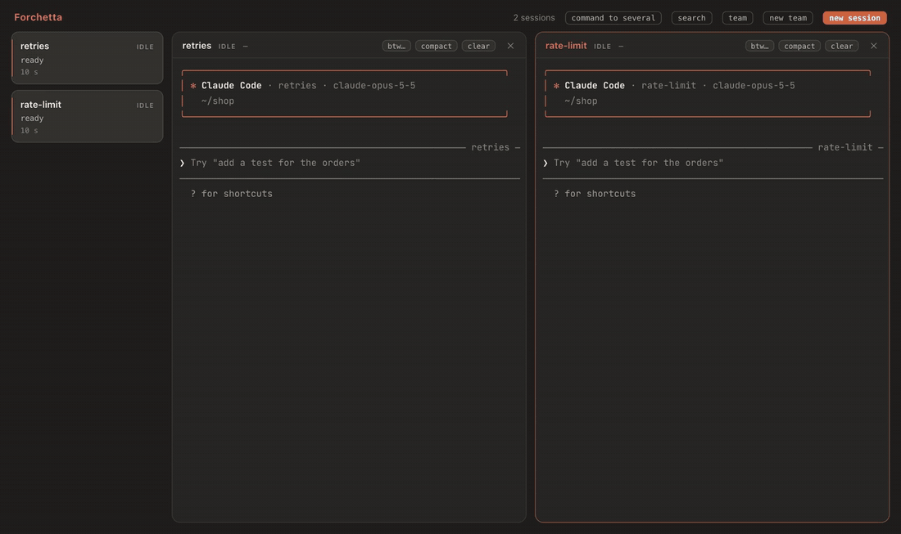

<div align="center">


# Forchetta

### Più sessioni di Claude Code nello stesso repository, senza che si pestino i piedi.

Quando due sessioni vogliono lo stesso file, Forchetta ne fa aspettare una, spiega a Claude perché, e la fa ripartire da sola quando il file è libero. Intorno a questo: tutte le sessioni di Claude Code del tuo Mac in una finestra, i permessi risolti da lì, una notifica quando una ha bisogno di te, e i team di agenti.

[](#installazione)
[](#installazione)
[](https://code.claude.com)
[](#cosa-tocca-sul-tuo-mac)
[](https://github.com/alessiodonato/forchetta/actions/workflows/ci.yml)
[](LICENSE)
[](https://forchetta.dev/)

[Installazione](#installazione) ·
[Provalo nel browser](https://forchetta.dev/demo/) ·
[Il vigile](#il-vigile) ·
[Rispetto ad altri strumenti](#rispetto-ad-altri-strumenti) ·
[Manuale (in inglese)](https://forchetta.dev/manual.html) ·
[🇬🇧 English](README.md)

<br>



<sub>Due sessioni, un file: <code>rate-limit</code> viene fermata mentre <code>retries</code> cambia <code>src/api.ts</code>, e riparte da sola quando il file è libero. Registrato nella simulazione del repository: app, daemon e vigile sono quelli veri; le due sessioni seguono un copione.</sub>

</div>

## Perché Forchetta

L'app e i comandi da terminale sono in inglese: in questo README pulsanti e messaggi sono citati come compaiono.

### Il vigile

Il modo solito di far lavorare più agenti in parallelo è un worktree git per ognuno. Poi però ogni worktree vuole le sue dipendenze, il suo `.env` e il suo server di sviluppo, e alla fine si unisce tutto. Con Forchetta le sessioni possono lavorare anche fianco a fianco nella stessa cartella:

- una sessione **tiene** i file che scrive durante il suo turno;
- un'altra sessione che prova a modificarne uno viene fermata, e Claude legge il perché: fa altro, o chiude il turno dicendo che aspetta;
- quando il turno che teneva il file finisce, la sessione in attesa viene avvisata che il file è libero, e riparte da sola;
- un comando git che cambierebbe i file sotto a un'altra sessione (`checkout`, `reset --hard`, `stash`, `pull`…) ti chiede prima conferma.

E dice a ogni sessione cosa hanno fatto le altre, proprio quando serve:

- **quando arriva**: chi sta cambiando quali file a metà, così si organizza fin dall'inizio;
- **un file che ha letto è cambiato**: chi l'ha cambiato, e le righe. Con i worktree lo scopri al merge; qui la sessione si adatta subito;
- **prima dei test o di una build**: quali file le altre stanno cambiando a metà, così i loro errori non vengono presi per bug suoi;
- **righe aggiunte da un'altra sessione** che sta per togliere: fermata una volta, così nessun lavoro viene annullato senza saperlo;
- **un `git add -A`** che si porterebbe dietro le modifiche di un'altra sessione: fermato una volta, con i suoi file da aggiungere al posto;
- **un dev server già acceso** nella cartella: il suo indirizzo, invece di un secondo; un kill di un processo di un'altra sessione ti chiede prima conferma.

Vale per tutte le sessioni, anche per quelle avviate con `claude` normale. **let it through**, nel box, lo scavalca. [Il vigile nel manuale](https://forchetta.dev/manual.html#guard).

### Funziona con il `claude` che usi già

Forchetta ascolta Claude Code attraverso i suoi hook, quindi le sessioni compaiono ovunque tu le abbia avviate: nel Terminale, in iTerm, nel tuo editor. Stessa CLI, stesse impostazioni, stessi hook tuoi. Nessun account, nessun nuovo ambiente per gli agenti, e niente delle tue sessioni esce dal tuo Mac.

Avvia una sessione con `forchetta run claude`, o dall'app, e Forchetta può anche aprirne il terminale e scriverci i comandi.

### Una finestra per tutte


- Un box aggiornato in tempo reale per ogni sessione: lo stato, cosa sta facendo, un breve riassunto, il contesto e il costo. Ambra quando aspetta te, verde quando ha finito, rosso per un errore, e un pallino su un risultato che non hai ancora guardato.
- I limiti del tuo piano in alto (`5h 62% · week 31%`), e quando finirà quello di 5 ore a questo ritmo.
- Rispondi ai permessi dal box, una volta o "always".
- Una notifica quando una sessione ti aspetta, sembra bloccata, gira a vuoto (lo stesso comando che fallisce allo stesso modo, più e più volte) o finisce con un errore.
- Cosa ha fatto il vigile questa settimana, in alto; `forchetta stats` nel terminale.
- Fino a quattro terminali veri affiancati.

### I team, quando servono

Un capo, che è una sessione Claude oppure tu, e quanti membri servono, su quanti livelli servono: un junior può rispondere a un senior che risponde al capo, e ogni relazione ha un suo prompt. Ogni membro è una sessione di Claude Code completa, con il suo ruolo e il suo modello e, di default, il suo worktree. Le richieste scendono lungo l'organigramma attraverso un server MCP; i membri rispondono, o fanno una domanda a chi sta sopra quando sono bloccati, e la risposta di un senior sale solo quando il lavoro del suo junior è finito. Dai a un membro i suoi file, e il vigile lo tiene lì dentro e gli altri fuori. Un membro che fa la revisione approva i commit, e il vigile ti chiede conferma prima del merge di qualcosa che non ha approvato. I token e il costo di ogni agente, e del team, si vedono mentre lavorano. Disegna un team nello studio, trascinando agenti, team interi e skill (open source, o tue) su una tela e tirando frecce tra loro (una skill si scarica solo quando un team la usa, fuori dal progetto); salvalo come modello e riavvialo in un altro progetto, oppure descrivi i tuoi team in un documento e chiedi a una sessione qualsiasi di prepararli: salva i modelli, e tu li avvii dall'app. Un team si può anche disegnare nel browser con lo [Studio Maker](https://forchetta.dev/studio/) e aprirne il file in Forchetta. [I team nel manuale](https://forchetta.dev/manual.html#teams).

## Rispetto ad altri strumenti

| | Cos'è | In cosa Forchetta è diversa |
|---|---|---|
| **Agent View** (`claude agents`) | La lista a schermo intero delle sessioni in background, di Anthropic, nel terminale | Una finestra che resta aperta accanto al tuo lavoro, con i terminali affiancati, e il vigile. |
| **Claude Desktop** | L'app di Anthropic, con le sessioni in parallelo nella barra laterale | Lavora con la CLI `claude` che usi già nei tuoi terminali, con i tuoi hook e le tue impostazioni. |
| **Agent teams** (sperimentali in Claude Code) | Una sessione capo che avvia i compagni e divide con loro una lista di compiti | I team si preparano in un pannello o si disegnano in uno studio, su quanti livelli servono, e si salvano come modelli: ruolo, modello, permessi, worktree e skill per ogni membro. Il capo puoi essere tu. |
| **Conductor** e app per Mac simili | App che fanno girare più agenti, ognuno in uno spazio di lavoro isolato | Forchetta non ospita le tue sessioni: vede quelle che avvii ovunque, e le lascia lavorare nella stessa cartella senza danni. |
| **Orca**, **Paseo** | App open source per desktop e telefono che fanno girare molti tipi di agenti, ognuno nel suo worktree git | Nessun worktree da preparare: le sessioni lavorano nella stessa cartella, e il vigile le tiene lontane dai file delle altre. Funziona con il `claude` che già usi, in qualsiasi terminale. |
| **cmux**, **Claude Squad** | Terminali e gestori di sessioni per molti tipi di agenti | Fatta solo per Claude Code, attraverso i suoi hook: il vigile, permessi dal box, contesto e costo per sessione, subagenti. |

Non si escludono a vicenda: le sessioni avviate in qualsiasi terminale compaiono in Forchetta.

## Installazione

```sh
brew install alessiodonato/tap/forchetta
forchetta setup
```

`forchetta setup` compila l'app sul tuo Mac e la mette in `~/Applications`, con i Command Line Tools di Xcode che Homebrew ha già installato: niente Xcode, niente account Apple, e nessun avviso di macOS quando si apre. Poi aggiunge gli hook di Forchetta a Claude Code, mostrandoti prima ogni modifica a `~/.claude/settings.json`.

Apri Forchetta da `~/Applications`: le sessioni già aperte compaiono da sole. Perché ogni nuova sessione sia una in cui Forchetta può scrivere, aggiungi `alias claude='forchetta run claude'` a `~/.zshrc`.

Versione 0.10.0. Servono macOS 12 o successivo e Claude Code (versione verificata 2.1.322); Homebrew porta con sé Node.js e tmux. Dopo `brew upgrade forchetta`, riesegui `forchetta setup`.

Per compilarla dal codice, vedi [CONTRIBUTING.md](CONTRIBUTING.md) (in inglese).

## Prova il vigile

1. In un repository git, apri due terminali e avvia in ognuno una sessione con `forchetta run claude`.
2. Chiedi alla prima di cambiare un file e poi far girare i test: *"Aggiungi i retry in src/api.ts, poi fai girare i test."*
3. Mentre lavora, chiedi alla seconda di cambiare lo stesso file.

La seconda sessione viene fermata, dice che aspetterà `src/api.ts`, e riparte quando la prima finisce il turno. In Forchetta, i due box mostrano chi tiene il file e chi aspetta.

## Cos'altro fa

- **Comandi**: `/btw`, `/compact` e `/clear` a una sessione o a più insieme, scritti solo quando è sicuro: mai dentro un dialogo, mai sopra una tua bozza. [Altro](https://forchetta.dev/manual.html#commands)
- **Passaggi di lavoro**: seleziona del testo in un terminale per chiederne a Claude, o per mandarlo a un'altra sessione. [Altro](https://forchetta.dev/manual.html#selection)
- **Cosa ha fatto ogni sessione**: i file che ha cambiato, i subagenti al lavoro, gli artefatti che ha pubblicato su claude.ai, e un avviso quando due sessioni hanno scritto lo stesso file. [Altro](https://forchetta.dev/manual.html#changes)
- **Nuove sessioni e nuovi team dall'app**, con modello, modalità dei permessi e worktree. [Altro](https://forchetta.dev/manual.html#new-session)
- **Nomi, gruppi e ruoli**, con un organigramma. [Altro](https://forchetta.dev/manual.html#window)
- **Icona nella barra dei menu**, badge nel Dock e la scorciatoia ⌃⌥F. [Altro](https://forchetta.dev/manual.html#alerts)
- **Team nel repository**: `.forchetta/` tiene i file dei team, le regole per ogni team e le impostazioni del vigile per quel repo, revisionati col codice; `forchetta team start review-squad --goal "…"` ne avvia uno da un terminale o da uno script, e un budget per team ti avvisa quando costa di più. [Altro](https://forchetta.dev/manual.html#repo-teams)
- **Report**: ogni turno, costo, file, passo del vigile, richiesta e revisione finisce in un registro locale; `forchetta report --since 7d --by team` lo legge come tabella, CSV o JSON. [Altro](https://forchetta.dev/manual.html#report)
- **Impostazioni, ⌘K e scorciatoie**: le impostazioni nell'app, una palette per ogni comando e sessione, un tema chiaro, i box che si aprono da tastiera. [Altro](https://forchetta.dev/manual.html#settings)
- **`forchetta doctor`** dice cosa non è a posto e come sistemarlo; `--bundle` scrive un file da allegare a una issue, senza i tuoi nomi. [Altro](https://forchetta.dev/manual.html#cli)
- **`forchetta ls --json`**, per gli script. [Altro](https://forchetta.dev/manual.html#cli)

Tutto il resto è nel [manuale](https://forchetta.dev/manual.html) (in inglese).

## Cosa tocca sul tuo Mac

- **`~/.claude/settings.json`**, solo con `forchetta setup` o `forchetta hooks install`, dopo averti mostrato ogni modifica, e con un backup. Gli hook di Forchetta si aggiungono accanto ai tuoi senza cambiarli; `forchetta hooks uninstall` toglie solo quelli.
- **Gli hook sono piccoli script `sh` + `curl`.** Terminano sempre con 0 e stampano solo una decisione: la tua risposta a un permesso, o il vigile che ferma una modifica. Con Forchetta spenta, una sessione si comporta esattamente come senza (la sua status line dice che Forchetta è spenta). Quasi tutti girano in background; il vigile fa aspettare Claude circa 30 ms, solo prima delle modifiche ai file e dei comandi Bash. [Come funzionano gli hook](https://forchetta.dev/manual.html#hooks)
- **Tutto il resto** sta in `~/Library/Application Support/Forchetta`, leggibile solo da te. Il daemon ascolta solo su `127.0.0.1`, con un token. Nessuna telemetria. L'unica chiamata esterna che porta fuori qualcosa di tuo è facoltativa e spenta di default: un riassunto di una riga scritto da Haiku, attraverso la Claude API. Quando parte un team i cui agenti hanno delle skill, Forchetta le scarica da GitHub a un commit fissato, in quella cartella.
- **`~/Library/LaunchAgents/dev.forchetta.daemon.plist`**, solo se lanci `forchetta daemon keepalive on`, perché macOS tenga acceso il daemon.
- A riposo, app, pagina e daemon insieme restano sotto l'1% della CPU.

## Funziona con arricurdAI

[arricurdAI](https://github.com/alessiodonato/arricurdai) tiene piccolo il contesto di Claude Code e mostra dove vanno i token. Forchetta funziona anche senza; con arricurdAI mostra in più il countdown della cache di ogni sessione, il costo di oggi, la ricerca nelle sessioni passate, e una nota per la nuova conversazione prima di un `/clear`.

## Disinstallazione

1. `forchetta hooks uninstall`: toglie solo gli hook di Forchetta, dopo averti chiesto, e ti restituisce la tua statusline.
2. `forchetta daemon stop`. Le sessioni avviate con `forchetta run` continuano finché non le chiudi con `/exit`.
3. `brew uninstall forchetta` e `brew untap alessiodonato/tap`.
4. Cancella `~/Applications/Forchetta.app` e `~/Library/Application Support/Forchetta`.

## Contribuire

Forchetta è giovane e ha un solo manutentore. I bug vanno nelle [issue](https://github.com/alessiodonato/forchetta/issues/new/choose), idee e domande nelle [discussioni](https://github.com/alessiodonato/forchetta/discussions). [CONTRIBUTING.md](CONTRIBUTING.md) (in inglese) spiega come compilarla e come provare una modifica in una simulazione, senza sessioni vere e senza spendere token.

## Licenza

Apache 2.0: vedi [LICENSE](LICENSE). I terminali dell'app usano [JetBrains Mono](https://github.com/JetBrains/JetBrainsMono), con licenza SIL Open Font License 1.1: vedi [src/ui/fonts/OFL.txt](src/ui/fonts/OFL.txt).

<sub>*Forchetta* in inglese si dice *fork*: un manico, più rebbi.</sub>
