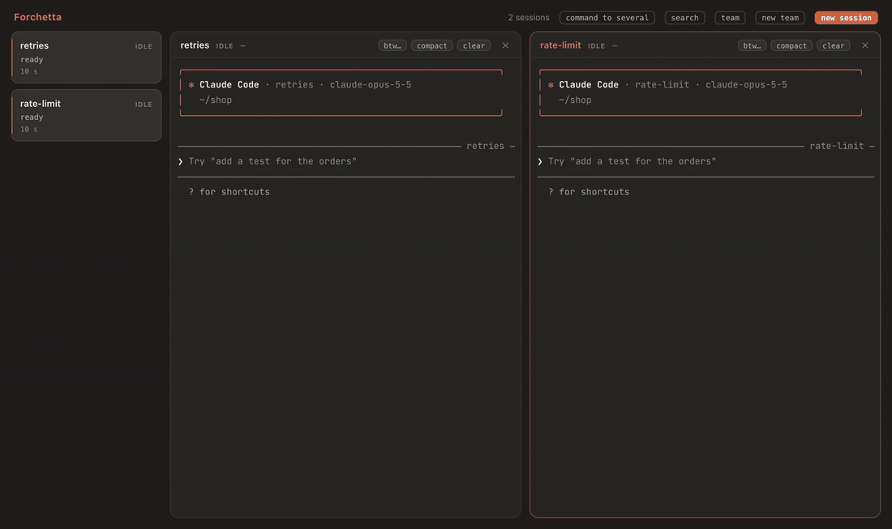

<div align="center">


# Forchetta

### Più sessioni di Claude Code nello stesso repository, senza che si pestino i piedi.

Quando due sessioni vogliono lo stesso file, Forchetta ne fa aspettare una, spiega a Claude perché, e la fa ripartire da sola quando il file è libero. Intorno a questo: tutte le sessioni di Claude Code del tuo Mac in una finestra, i permessi risolti da lì, una notifica quando una ha bisogno di te, e i team di agenti.

[](#installazione)
[](#installazione)
[](https://code.claude.com)
[](#cosa-tocca-sul-tuo-mac)
[](https://github.com/alessiodonato/forchetta/actions/workflows/ci.yml)
[](LICENSE)
[](https://alessiodonato.github.io/forchetta/)

[Installazione](#installazione) ·
[Il vigile](#il-vigile) ·
[Rispetto ad altri strumenti](#rispetto-ad-altri-strumenti) ·
[Manuale (in inglese)](https://alessiodonato.github.io/forchetta/manual.html) ·
[🇬🇧 English](README.md)

<br>



<sub>Due sessioni, un file: <code>rate-limit</code> viene fermata mentre <code>retries</code> cambia <code>src/api.ts</code>, e riparte da sola quando il file è libero. Registrato nella simulazione del repository: app, daemon e vigile sono quelli veri; le due sessioni seguono un copione.</sub>

</div>

## Perché Forchetta

L'app e i comandi da terminale sono in inglese: in questo README pulsanti e messaggi sono citati come compaiono.

### Il vigile

Il modo solito di far lavorare più agenti in parallelo è un worktree git per ognuno. Poi però ogni worktree vuole le sue dipendenze, il suo `.env` e il suo server di sviluppo, e alla fine si unisce tutto. Con Forchetta le sessioni possono lavorare anche fianco a fianco nella stessa cartella:

- una sessione **tiene** i file che scrive durante il suo turno;
- un'altra sessione che prova a modificarne uno viene fermata, e Claude legge il perché: fa altro, o chiude il turno dicendo che aspetta;
- quando il turno che teneva il file finisce, la sessione in attesa viene avvisata che il file è libero, e riparte da sola;
- un comando git che cambierebbe i file sotto a un'altra sessione (`checkout`, `reset --hard`, `stash`, `pull`…) ti chiede prima conferma.

Vale per tutte le sessioni, anche per quelle avviate con `claude` normale. **let it through**, nel box, lo scavalca. [Il vigile nel manuale](https://alessiodonato.github.io/forchetta/manual.html#guard).

### Funziona con il `claude` che usi già

Forchetta ascolta Claude Code attraverso i suoi hook, quindi le sessioni compaiono ovunque tu le abbia avviate: nel Terminale, in iTerm, nel tuo editor. Stessa CLI, stesse impostazioni, stessi hook tuoi. Nessun account, nessun nuovo ambiente per gli agenti, e niente delle tue sessioni esce dal tuo Mac.

Avvia una sessione con `forchetta run claude`, o dall'app, e Forchetta può anche aprirne il terminale e scriverci i comandi.

### Una finestra per tutte


- Un box aggiornato in tempo reale per ogni sessione: lo stato, cosa sta facendo, un breve riassunto, il contesto e il costo. Ambra quando aspetta te, verde quando ha finito, rosso per un errore.
- Rispondi ai permessi dal box, una volta o "always".
- Una notifica quando una sessione ti aspetta, sembra bloccata o finisce con un errore.
- Fino a quattro terminali veri affiancati.

### I team, quando servono

Un capo, che è una sessione Claude oppure tu, e fino a 6 membri. Ogni membro è una sessione di Claude Code completa, con il suo ruolo e il suo modello e, di default, il suo worktree. Il capo distribuisce le richieste attraverso un server MCP; i membri rispondono, o gli fanno una domanda quando sono bloccati. Salva il team come modello e riavvialo in un altro progetto. [I team nel manuale](https://alessiodonato.github.io/forchetta/manual.html#teams).

## Rispetto ad altri strumenti

| | Cos'è | In cosa Forchetta è diversa |
|---|---|---|
| **Agent View** (`claude agents`) | La lista a schermo intero delle sessioni in background, di Anthropic, nel terminale | Una finestra che resta aperta accanto al tuo lavoro, con i terminali affiancati, e il vigile. |
| **Claude Desktop** | L'app di Anthropic, con le sessioni in parallelo nella barra laterale | Lavora con la CLI `claude` che usi già nei tuoi terminali, con i tuoi hook e le tue impostazioni. |
| **Agent teams** (sperimentali in Claude Code) | Una sessione capo che avvia i compagni e divide con loro una lista di compiti | I team si preparano in un pannello e si salvano come modelli: ruolo, modello, permessi e worktree per ogni membro. Il capo puoi essere tu. |
| **Conductor** e app per Mac simili | App che fanno girare più agenti, ognuno in uno spazio di lavoro isolato | Forchetta non ospita le tue sessioni: vede quelle che avvii ovunque, e le lascia lavorare nella stessa cartella senza danni. |
| **cmux**, **Claude Squad** | Terminali e gestori di sessioni per molti tipi di agenti | Fatta solo per Claude Code, attraverso i suoi hook: il vigile, permessi dal box, contesto e costo per sessione, subagenti. |

Non si escludono a vicenda: le sessioni avviate in qualsiasi terminale compaiono in Forchetta.

## Installazione

```sh
brew install alessiodonato/tap/forchetta
forchetta setup
```

`forchetta setup` compila l'app sul tuo Mac e la mette in `~/Applications`, con i Command Line Tools di Xcode che Homebrew ha già installato: niente Xcode, niente account Apple, e nessun avviso di macOS quando si apre. Poi aggiunge gli hook di Forchetta a Claude Code, mostrandoti prima ogni modifica a `~/.claude/settings.json`.

Apri Forchetta da `~/Applications`: le sessioni già aperte compaiono da sole. Perché ogni nuova sessione sia una in cui Forchetta può scrivere, aggiungi `alias claude='forchetta run claude'` a `~/.zshrc`.

Versione 0.9.1. Servono macOS 12 o successivo e Claude Code (versione verificata 2.1.322); Homebrew porta con sé Node.js e tmux. Dopo `brew upgrade forchetta`, riesegui `forchetta setup`.

Per compilarla dal codice, vedi [CONTRIBUTING.md](CONTRIBUTING.md) (in inglese).

## Prova il vigile

1. In un repository git, apri due terminali e avvia in ognuno una sessione con `forchetta run claude`.
2. Chiedi alla prima di cambiare un file e poi far girare i test: *"Aggiungi i retry in src/api.ts, poi fai girare i test."*
3. Mentre lavora, chiedi alla seconda di cambiare lo stesso file.

La seconda sessione viene fermata, dice che aspetterà `src/api.ts`, e riparte quando la prima finisce il turno. In Forchetta, i due box mostrano chi tiene il file e chi aspetta.

## Cos'altro fa

- **Comandi**: `/btw`, `/compact` e `/clear` a una sessione o a più insieme, scritti solo quando è sicuro: mai dentro un dialogo, mai sopra una tua bozza. [Altro](https://alessiodonato.github.io/forchetta/manual.html#commands)
- **Passaggi di lavoro**: seleziona del testo in un terminale per chiederne a Claude, o per mandarlo a un'altra sessione. [Altro](https://alessiodonato.github.io/forchetta/manual.html#selection)
- **Cosa ha fatto ogni sessione**: i file che ha cambiato, i subagenti al lavoro, gli artefatti che ha pubblicato su claude.ai, e un avviso quando due sessioni hanno scritto lo stesso file. [Altro](https://alessiodonato.github.io/forchetta/manual.html#changes)
- **Nuove sessioni e nuovi team dall'app**, con modello, modalità dei permessi e worktree. [Altro](https://alessiodonato.github.io/forchetta/manual.html#new-session)
- **Nomi, gruppi e ruoli**, con un organigramma. [Altro](https://alessiodonato.github.io/forchetta/manual.html#window)
- **Icona nella barra dei menu**, badge nel Dock e la scorciatoia ⌃⌥F. [Altro](https://alessiodonato.github.io/forchetta/manual.html#alerts)
- **`forchetta ls --json`**, per gli script. [Altro](https://alessiodonato.github.io/forchetta/manual.html#cli)

Tutto il resto è nel [manuale](https://alessiodonato.github.io/forchetta/manual.html) (in inglese).

## Cosa tocca sul tuo Mac

- **`~/.claude/settings.json`**, solo con `forchetta setup` o `forchetta hooks install`, dopo averti mostrato ogni modifica, e con un backup. Gli hook di Forchetta si aggiungono accanto ai tuoi senza cambiarli; `forchetta hooks uninstall` toglie solo quelli.
- **Gli hook sono piccoli script `sh` + `curl`.** Terminano sempre con 0 e stampano solo una decisione: la tua risposta a un permesso, o il vigile che ferma una modifica. Con Forchetta spenta, una sessione si comporta esattamente come senza. Quasi tutti girano in background; il vigile fa aspettare Claude circa 30 ms, solo prima delle modifiche ai file e dei comandi Bash. [Come funzionano gli hook](https://alessiodonato.github.io/forchetta/manual.html#hooks)
- **Tutto il resto** sta in `~/Library/Application Support/Forchetta`, leggibile solo da te. Il daemon ascolta solo su `127.0.0.1`, con un token. Nessuna telemetria. L'unica chiamata esterna è facoltativa e spenta di default: un riassunto di una riga scritto da Haiku, attraverso la Claude API.
- A riposo, app, pagina e daemon insieme restano sotto l'1% della CPU.

## Funziona con arricurdAI

[arricurdAI](https://github.com/alessiodonato/arricurdai) tiene piccolo il contesto di Claude Code e mostra dove vanno i token. Forchetta funziona anche senza; con arricurdAI mostra in più il contesto e il countdown della cache di ogni sessione, il costo di oggi, la ricerca nelle sessioni passate, e una nota per la nuova conversazione prima di un `/clear`.

## Disinstallazione

1. `forchetta hooks uninstall`: toglie solo gli hook di Forchetta, dopo averti chiesto, e ti restituisce la tua statusline.
2. `forchetta daemon stop`. Le sessioni avviate con `forchetta run` continuano finché non le chiudi con `/exit`.
3. `brew uninstall forchetta` e `brew untap alessiodonato/tap`.
4. Cancella `~/Applications/Forchetta.app` e `~/Library/Application Support/Forchetta`.

## Contribuire

Forchetta è giovane e ha un solo manutentore. I bug vanno nelle [issue](https://github.com/alessiodonato/forchetta/issues/new/choose), idee e domande nelle [discussioni](https://github.com/alessiodonato/forchetta/discussions). [CONTRIBUTING.md](CONTRIBUTING.md) (in inglese) spiega come compilarla e come provare una modifica in una simulazione, senza sessioni vere e senza spendere token.

## Licenza

Apache 2.0: vedi [LICENSE](LICENSE). I terminali dell'app usano [JetBrains Mono](https://github.com/JetBrains/JetBrainsMono), con licenza SIL Open Font License 1.1: vedi [src/ui/fonts/OFL.txt](src/ui/fonts/OFL.txt).

<sub>*Forchetta* in inglese si dice *fork*: un manico, più rebbi.</sub>
