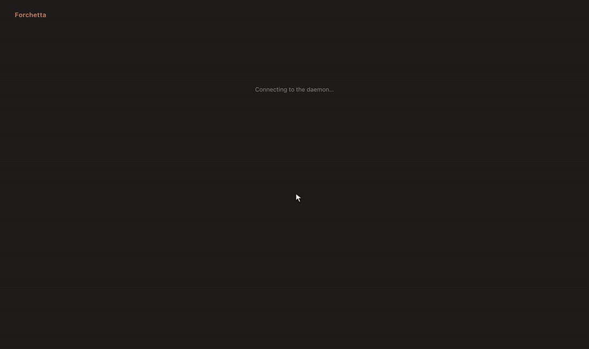
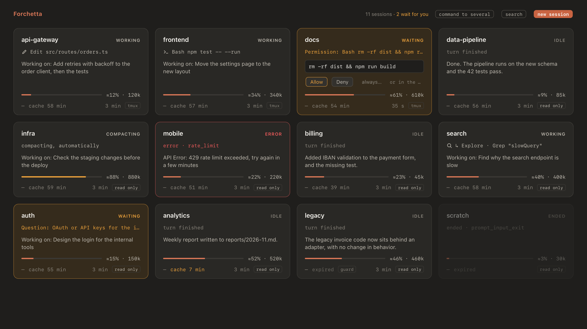
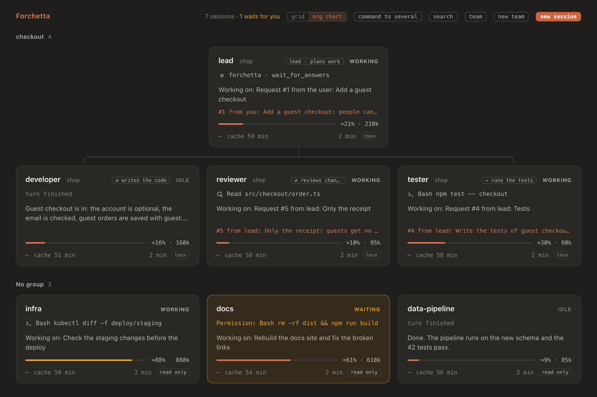
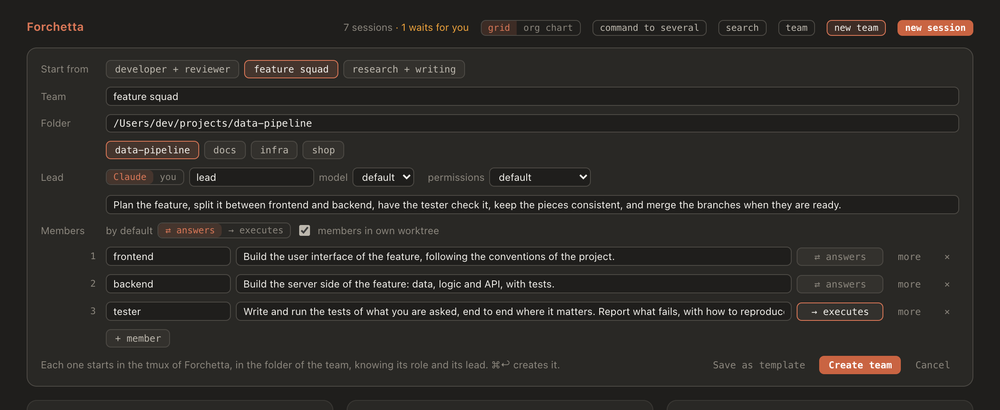
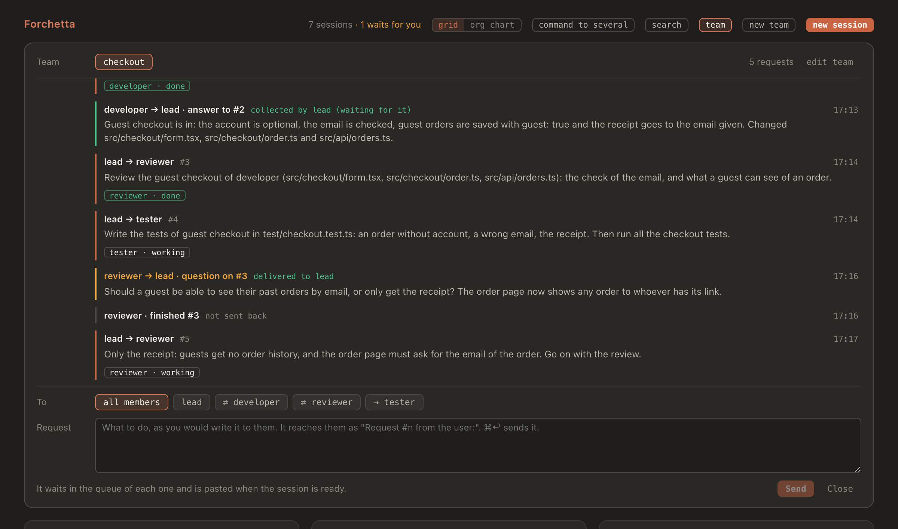
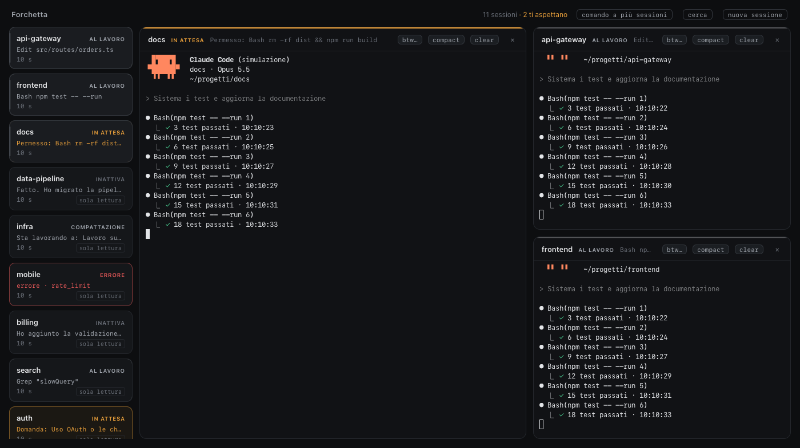
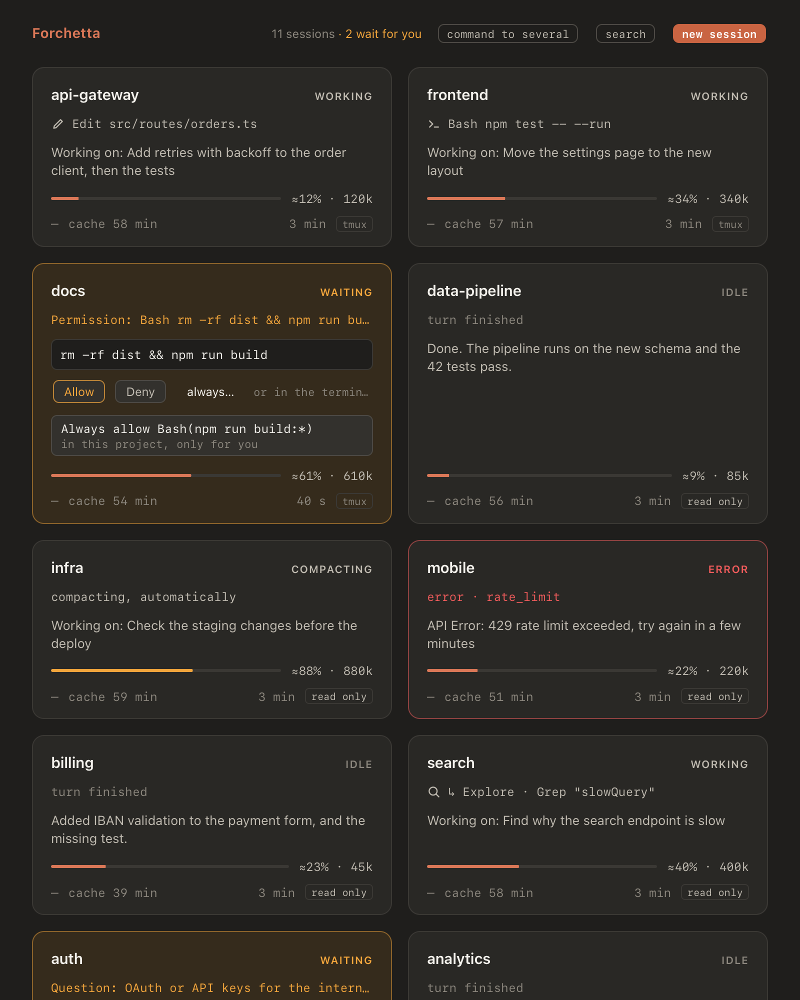
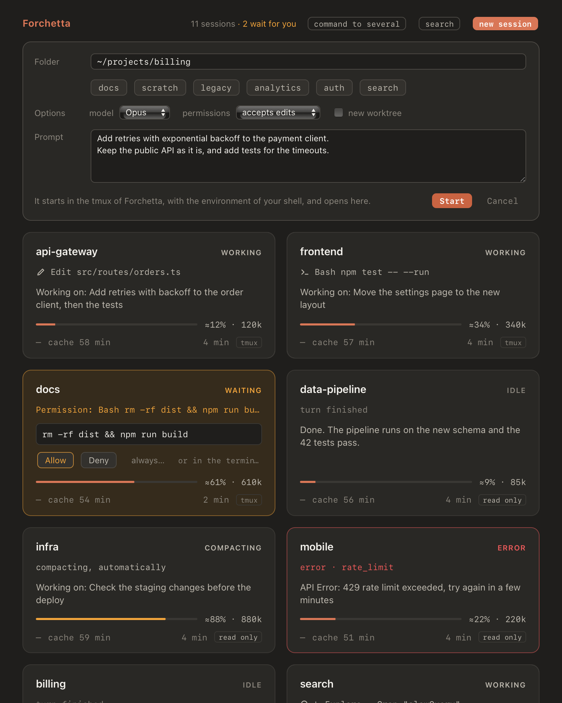
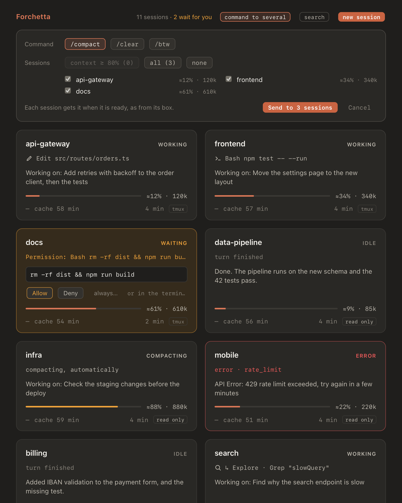

<div align="center">


# Forchetta

### Tutte le sessioni di Claude Code del tuo Mac, in una finestra.

Forchetta trova le sessioni di Claude Code che hai aperto e mostra in tempo reale cosa sta facendo ognuna, cosa aspetta e quanto è costata. Ne apri fino a quattro affiancate, rispondi ai permessi dal loro box, ricevi una notifica quando una ha bisogno di te e avvii team di agenti che lavorano insieme.

[](#installazione)
[](#installazione)
[](https://code.claude.com)
[](#disinstallazione)
[](LICENSE)
[](https://alessiodonato.github.io/forchetta/)

[Installazione](#installazione) ·
[Cosa fa](#cosa-fa) ·
[Team di agenti](#team-di-agenti) ·
[arricurdAI](#funziona-con-arricurdai) ·
[Manuale (in inglese)](https://alessiodonato.github.io/forchetta/manual.html) ·
[Disinstallazione](#disinstallazione) ·
[🇬🇧 English](README.md)

<br>



<sub>Un team di agenti al lavoro. Registrato nella simulazione di questo repository (<code>scripts/dev</code>): le sessioni sono controfigure di Claude Code con un copione, mentre app, daemon e coda sono quelli veri.</sub>

</div>

## Cosa fa

Versione 0.8.0:
- trova da sola le sessioni Claude Code attive e mostra per ognuna un box con stato, azione in corso, riassunto, contesto, cache e costo;
- apre fino a 4 sessioni affiancate in terminali veri, agganciati a tmux;
- manda `/btw`, `/compact` e `/clear` a una o più sessioni, solo quando è sicuro;
- risponde ai permessi dal box (una volta o "always"), notifica le attese, gli stalli e gli errori, avvisa dei conflitti tra sessioni sugli stessi file;
- avvia **team di agenti**: un capo (una sessione Claude, oppure tu) e fino a 6 membri, ognuno una sessione di Claude Code, che si passano richieste, risposte e domande; ogni membro risponde al suo capo (⇄) o esegue soltanto (→), e può lavorare in un worktree git tutto suo;
- mostra le modifiche di ogni sessione e gli artefatti che ha pubblicato su claude.ai, avvia sessioni nuove, organizza le sessioni in gruppi e ruoli, cerca nelle sessioni passate con arricurdAI;
- sta nella barra dei menu, con la scorciatoia ⌃⌥F.

Tutto gira in locale. L'unico servizio esterno, facoltativo e spento di default, è la Claude API per i riassunti.

L'app e i comandi da terminale sono in inglese: in questo README pulsanti e messaggi sono citati come compaiono.

## Installazione

```sh
brew install alessiodonato/tap/forchetta
forchetta setup
```

Homebrew installa con lei anche Node.js e tmux. `forchetta setup`:
- compila l'app sul tuo Mac e la mette in `~/Applications`. Usa i Command Line Tools di Xcode, che Homebrew ha già installato: niente Xcode, niente account Apple. Compilata sul tuo Mac, l'app si apre senza avvisi di macOS;
- aggiunge gli hook di Forchetta a Claude Code, mostrandoti prima ogni modifica a `~/.claude/settings.json`, e il diff completo se lo vuoi (vedi [Hook di Claude Code](#hook-di-claude-code));
- ti dice dove stanno i dati.

Poi apri Forchetta da `~/Applications`. Le sessioni già aperte compaiono da sole. Per aprire nell'app il terminale di una sessione, avviala con `forchetta run claude` o con **new session** nell'app.

Dopo `brew upgrade forchetta` riesegui `forchetta setup`: ricompila l'app solo se è cambiata.

Servono macOS 12 o successivo e Claude Code (versione verificata 2.1.322). Facoltativo: [arricurdAI](#funziona-con-arricurdai).

**Dove stanno i dati.** Forchetta tiene tutto quello che scrive in `~/Library/Application Support/Forchetta`, leggibile solo da te: il token del daemon, il socket di tmux, lo stato delle sessioni, i log, i backup, le impostazioni in `config.json`. In un clone è `var/` dentro il clone. Più sotto, `var/` indica questa cartella.

### Dal codice

```sh
git clone https://github.com/alessiodonato/forchetta.git
cd forchetta
pnpm install          # anche: rende eseguibile lo spawn-helper di node-pty
pnpm build            # CLI, daemon e pagina dell'app in dist/
bin/forchetta setup   # l'app in ~/Applications, e gli hook
```

Servono Node.js 22 o successivo, pnpm e tmux (`brew install tmux`). `pnpm build:app` compila invece l'app in `build/`, per lo sviluppo. Per avere il comando `forchetta` nel terminale, aggiungi a `~/.zshrc`:

```sh
alias forchetta=/percorso/di/forchetta/bin/forchetta
```

## Funziona con arricurdAI

[arricurdAI](https://github.com/alessiodonato/arricurdai) tiene piccolo il contesto di Claude Code e mostra dove vanno i token. Forchetta funziona anche senza; con arricurdAI mostra in più:
- il contesto di ogni sessione e il countdown della sua cache del prompt;
- il badge `guard`, quando arricurdAI fermerà il prossimo prompt;
- il costo e i token di oggi, di tutte le sessioni (vedi [Costo e token](#costo-e-token));
- **search**: le sessioni passate di un progetto, con i segreti nascosti (`arricurdai recall`);
- prima di un `/clear` dal box, una nota per la nuova sessione, così riparte da dove era rimasta la vecchia (arricurdAI 0.5.0 o successivo).

L'icona nella barra dei menu sostituisce il plugin di arricurdAI per SwiftBar. Forchetta trova arricurdAI nel PATH o nei suoi hook.

## Hook di Claude Code

Forchetta sa cosa fanno le sessioni grazie agli hook di Claude Code. Li installa `forchetta setup`; da soli:

```sh
forchetta hooks install
```

Il comando:
- elenca ogni modifica a `~/.claude/settings.json` e chiede conferma prima di scrivere: rispondi `d` per vedere prima il diff completo, oppure passa `--diff`;
- mette anche `bin/forchetta-statusline` davanti alla tua statusline, per il costo di ogni sessione (vedi [Costo e token](#costo-e-token));
- salva una copia del file in `var/backups/`;
- aggiunge i suoi hook **accanto** a quelli esistenti, per esempio quelli di arricurdAI, senza modificarli;
- vale anche per le sessioni già aperte, perché Claude Code rilegge gli hook da solo.

Tutti gli eventi passano da `bin/forchetta-hook`, un piccolo script `sh` + `curl` che inoltra l'evento al daemon locale. Lo script:
- non stampa nulla;
- termina sempre con 0, anche se il daemon è spento: le sessioni non mostrano mai errori e non vengono rallentate;
- per gli eventi frequenti gira in background, così Claude non lo aspetta.

`SessionStart` e `SessionEnd` invece sono sincroni: durano circa 30 ms.

`PermissionRequest` passa da `bin/forchetta-permission`, che aspetta la risposta del box (vedi [I permessi](#i-permessi-dal-box)). Il dialogo nel Terminale compare comunque, subito. Con il daemon spento lo script esce subito senza stampare nulla. Lo stesso succede con `claude -p` e con l'SDK, che non hanno un dialogo.

## Uso

```sh
forchetta run claude [argomenti di claude]   # come `claude`, ma dentro tmux
forchetta ls                                 # le sessioni e il loro stato
forchetta ls --json                          # lo stesso, in JSON per script e jq
forchetta daemon start|stop|status
```

`forchetta run claude` avvia Claude Code in un server tmux privato di Forchetta (`var/tmux.sock`, configurazione in `config/tmux.conf` di Forchetta) e aggancia il terminale corrente. Si usa come `claude`, con qualche differenza:

- **Chiudere la finestra del Terminale non termina la sessione:** la scollega soltanto. Claude continua a lavorare e Forchetta continua a mostrarla. Per chiudere la sessione usa `/exit`.
- Per scollegarti senza chiudere la finestra: `Ctrl-b d`.
- Per riagganciarti da un terminale: `tmux -S "$HOME/Library/Application Support/Forchetta/tmux.sock" attach -t fk-xxxxxxxx` (in un clone, `var/tmux.sock`). Il nome della sessione lo trovi con `tmux -S "$HOME/Library/Application Support/Forchetta/tmux.sock" ls`.

Le sessioni avviate con `claude` normale compaiono lo stesso in `forchetta ls`, ma **in sola lettura**: Forchetta non può mandare loro comandi.

Il daemon parte da solo con `forchetta run`. Fermarlo non ferma nessuna sessione.

### Alias opzionale: `claude` → `forchetta run claude`

Per passare da Forchetta ogni volta che scrivi `claude`, aggiungi a `~/.zshrc` (dopo l'alias di `forchetta`, in un clone):

```sh
alias claude='forchetta run claude'
```

`forchetta run` usa il percorso completo di `claude` salvato in `var/config.json`, quindi non c'è ricorsione. Per lanciare il `claude` originale una volta sola: `command claude`.

## L'app



Un box per ogni sessione. Compare da solo quando la sessione parte e sbiadisce quando termina; 10 minuti dopo sparisce. Ogni box mostra:
- il progetto e lo stato;
- l'azione in corso, per esempio `Edit src/api.ts` o `Bash npm test`, oppure cosa ti sta chiedendo;
- un riassunto breve, ricavato dagli eventi;
- il contesto: barra e token;
- il countdown della cache del prompt e il badge `guard` quando arricurdAI fermerà il prossimo prompt;
- il tempo dall'ultimo evento e se la sessione è comandabile (`tmux`) o in sola lettura.

**Gli stati si riconoscono anche da lontano:**
- **working**, al lavoro: il bordo pulsa piano;
- **waiting**, in attesa di te (permesso, domanda, piano da approvare): ambra, con un respiro;
- **turn finished**: verde per un attimo, con un check;
- **error**: rosso, con un solo scuotimento;
- **compacting**: la barra del contesto si stringe.

Ambra, verde e rosso indicano solo uno stato. L'arancione di Claude segna invece quello su cui puoi agire: i pulsanti che avviano qualcosa, ciò che hai scelto, il riquadro in cui stai scrivendo.

**Prestazioni e accessibilità.** Con "Riduci movimento" attivo (Preferenze di Sistema → Accessibilità → Monitor) gli stati restano riconoscibili ma fermi. Quando la finestra è ridotta a icona, nascosta o coperta, nulla si muove e il daemon smette di leggere arricurdAI.

Su un Mac Intel ogni animazione a 60 fps costa a WindowServer circa un quarto di core. Per questo le animazioni continue sono fluide solo nei primi secondi dopo ogni cambio di stato; poi proseguono tutte insieme a 12 passi al secondo. A riposo l'app, la pagina e il daemon insieme stanno sotto l'1% di CPU.

**Contesto e cache vengono da `arricurdai status`**: Forchetta mostra gli stessi numeri e non li ricalcola. arricurdAI viene trovato nel PATH o nei suoi hook, oppure si imposta in `var/config.json` (`"arricurdai": ["/percorso/arricurdai"]`). La percentuale è una stima (`≈`): arricurdAI dà i token, non la finestra del modello. Le finestre stanno in `var/config.json`, alla voce `contextWindows`: 1M di default, 200k per Haiku 4.5, Sonnet 4.6 e Opus 4.6.

### Nomi, gruppi e ruoli



Passando sopra un box compare **✎**, che permette di dare alla sessione:
- un **nome**, mostrato al posto della cartella (la cartella resta accanto, più piccola);
- un **gruppo**;
- un **ruolo** (testo libero, per esempio "revisione" o "test");
- il segno **lead of the group** (capo del gruppo).

L'assegnazione vale anche per la sua cartella (`var/teams.json`): una sessione che riparte nella stessa cartella, magari il giorno dopo, ritrova il suo posto. **Remove** cancella tutto.

Quando esiste almeno un gruppo, in alto compare **grid / org chart**. Nell'organigramma ogni gruppo ha la sua sezione, con i capi in alto e gli altri sotto, collegati; le sessioni senza gruppo stanno in fondo. Il nome scelto compare ovunque: nella colonna a sinistra, nei riquadri, nelle notifiche e negli avvisi di conflitto.

Anche un team di agenti (sezione seguente) è un gruppo: le sue sessioni ricevono nome, gruppo e ruolo quando partono.

### Team di agenti



Un team è un gruppo di sessioni di Claude Code che lavorano insieme: un **capo** (lead) dà le richieste, i **membri** le eseguono. Il capo è una sessione Claude, oppure tu. **new team**, in alto, apre il pannello:
- **Start from**: un modello che riempie il pannello con un clic: *developer + reviewer*, *feature squad* (frontend, backend, tester), *research + writing*, più quelli che hai salvato;
- il **nome** del team, che è anche il suo gruppo nell'organigramma, e la sua **cartella**;
- il **capo**: **Claude**, con nome, ruolo, modello e modalità dei permessi, oppure **you** (tu);
- i **membri**, fino a 6: un nome e, in una frase, cosa fa ognuno. In **more** ci sono modello, permessi e worktree di quel membro;
- come ogni membro parla con il suo capo:
  - **⇄ answers** (risponde): quando finisce una richiesta, il suo messaggio finale torna al capo. Se non può andare avanti, può fare una domanda al capo;
  - **→ executes** (esegue): fa il lavoro e non manda niente indietro;
- **members in own worktree**, acceso di default: ogni membro lavora in un worktree git tutto suo, così i membri non toccano mai i file l'uno dell'altro (vedi sotto).

**Create team** (⌘↩) avvia tutte le sessioni nel tmux di Forchetta, prima il capo. Dal suo prompt di sistema ognuna sa chi è, il suo ruolo, il suo capo e gli altri membri; il suo nome compare nel box, nel riquadro e in Claude Code (`--name`). **Save as template** salva il team senza la cartella (in `var/crew-templates.json`), per avviarlo di nuovo altrove.

**Come va il lavoro.** Dai l'obiettivo al capo: dal pannello **team**, oppure nel suo terminale. Un capo Claude lo divide con gli strumenti del team, un server MCP chiamato `forchetta` che ricevono solo le sessioni del team, senza permessi da chiedere:
- `send_request` dà lavoro a un membro, ad alcuni o a tutti. La richiesta riceve un numero e arriva a ogni membro come nuovo prompt, "Request #3 from lead:", appena la sua sessione è libera. Fino ad allora aspetta nella coda del membro, come i comandi del box e con gli stessi controlli;
- il messaggio finale di un membro che risponde arriva al capo come nuovo prompt: "Answer from developer to request #2:";
- `wait_for_answers` permette al capo di aspettare le risposte che gli servono, fino a 10 minuti, e di riceverle tutte insieme nello stesso turno, invece che un prompt ciascuna;
- `ask_lead` permette a un membro che risponde di chiedere al capo qualcosa sulla sua richiesta. La risposta torna come nuova richiesta;
- `team` mostra al capo i membri, cosa fa ognuno, su cosa sta lavorando e dov'è il suo worktree.

Quando il capo sei tu, le risposte e le domande dei membri arrivano a te, nel pannello del team.



**Il pannello del team.** **team**, in alto, compare quando esiste almeno un team. Mostra il filo del team, dal più vecchio:
- ogni richiesta, con chi l'ha mandata, a chi, e come va per ognuno: in coda, al lavoro, fatta;
- le risposte, e dove sono andate: consegnate al capo, raccolte dalla sua attesa, per te, oppure non mandate indietro (un membro che esegue soltanto, o uno che ha fatto una domanda al posto della risposta);
- le domande dei membri.

Sotto il filo scrivi tu una richiesta: al capo, a un membro o a tutti. Arriva come "Request #n from the user:". I box del team dicono su cosa lavora ogni sessione ("#4 from lead: write the tests…"), e il box di un capo Claude dice quali richieste sta ancora aspettando.

**edit team** cambia il team mentre lavora:
- **→ / ⇄** di un membro: vale dalla sua prossima richiesta, che glielo dice;
- **remove** toglie un membro dal team: le sue richieste ancora in coda vengono annullate e il suo box esce dal gruppo, ma la sua sessione continua (`/exit` la chiude);
- **+ member** aggiunge un membro, avviato come gli altri;
- **Save as template**.

Un capo Claude viene a sapere di ogni cambiamento con il suo prossimo prompt.

**Worktree e unione del lavoro.** Con **own worktree**, Claude Code crea per il membro un worktree git (`--worktree`, in `.claude/worktrees/` del repository), su un branch tutto suo. Il membro fa il commit del suo lavoro alla fine di ogni richiesta. Il capo resta nella cartella del team: il suo prompt di sistema gli dice di unire con git i branch dei membri quando il lavoro è buono, oppure di dirti che è pronto.
- La cartella deve stare in un repository git: altrimenti i membri la condividono.
- Claude Code crea un worktree solo in una cartella di cui si fida. Se non hai mai aperto quella cartella con `claude`, parte solo la prima sessione: rispondi al dialogo di fiducia nel suo terminale, e partono le altre, ognuna nel suo worktree.

**Limiti.** Al massimo 6 membri per team, e 20 richieste aperte insieme in un team: un capo non può distribuire più lavoro di quanto tu riesca a seguire. Una richiesta è lunga al massimo 20.000 caratteri; una lunga compare nel terminale del membro come `[Pasted text #1 +N lines]`, come quando la incolli tu. I team stanno in `var/crews/`, un file ciascuno, e tornano quando il daemon riparte.

### Costo e token

- **In alto, il totale di oggi**: "today ≈ $46.20 · 142M tokens". Comprende tutte le chiamate di tutte le sessioni da mezzanotte, anche quelle chiuse, a prezzi API. Viene da `arricurdai status`, come il contesto e la cache; passandoci sopra si leggono anche il numero di chiamate e le chiamate escluse perché il modello non ha un prezzo noto.
- **In ogni box, il costo della sessione** dal suo avvio (nel piè di pagina: "≈ $0.42"). Lo calcola Claude Code, come `/cost`, e arriva dalla statusline a ogni messaggio. Una sessione aperta da giorni può quindi costare più del totale di oggi.
- **I token della sessione** sono quelli del contesto, accanto alla barra: "≈36% · 357k". Con un arricurdAI che dà la parte di oggi di ogni sessione (`sessions[].today` in `status --json`), il piè di pagina aggiunge i token di oggi, subagenti compresi: "≈ $0.42 · today 1.2M tok". Il tooltip spiega le due fonti; la somma dei box dà il totale in alto.

Per il costo della sessione `forchetta hooks install` mette `bin/forchetta-statusline` davanti alla tua statusline:
- il tuo comando viene salvato in `var/statusline-command` ed eseguito con lo stesso input, quindi la riga in basso resta identica;
- con il daemon spento la statusline non cambia;
- `forchetta hooks uninstall` rimette il tuo comando.

La statusline di Claude Code dà anche dei token, ma sono quelli dell'ultima chiamata, non il totale della sessione, e Forchetta non li usa.

### Le modifiche di una sessione

Quando una sessione ha scritto dei file, il suo box mostra "3 files" nel piè di pagina; lo stesso pulsante è nell'intestazione di un riquadro aperto. Il clic apre un pannello con i file scritti dalla sessione, dal più recente, e due viste:
- **by this session**: solo quello che ha cambiato lei, modifica per modifica ("edit · 3 min ago", "file created"), come lo ha riportato Claude Code. Le modifiche di altre sessioni o tue allo stesso file qui non compaiono. Sono salvate in `var/patches/` (leggibili solo da te) e vengono cancellate quando la sessione esce dall'elenco;
- **since the last commit**: il diff della sua repo (`git diff HEAD`), cioè lo stato attuale del file. Un file nuovo compare per intero.

Altri dettagli:
- Esc o un clic fuori chiudono il pannello; **refresh** rilegge le modifiche;
- un file fuori da git non ha diff;
- un file già committato dice "no difference since the last commit";
- la vista dall'ultimo commit comprende anche le modifiche fatte da altri allo stesso file: per sapere chi altro l'ha toccato c'è l'avviso di conflitto;
- l'elenco comprende solo le scritture fatte con `Edit` e `Write`, come per i conflitti;
- il diff viene letto solo quando apri il pannello;
- `git` lavora in sola lettura, senza diff esterni, textconv né fsmonitor.

### Gli artefatti di claude.ai

Quando una sessione pubblica un artefatto su claude.ai, o ne apre uno, il suo box mostra "1 artifact" in basso, accanto a "3 files"; lo stesso pulsante c'è nell'intestazione del riquadro aperto. Con un artefatto solo, un clic lo apre nel browser. Con più artefatti, un clic mostra l'elenco, dal più recente: per ognuno il titolo, se la sessione l'ha pubblicato o aperto, e quando, più **copy** per copiarne il link.

- Forchetta prende link e titolo dall'hook dello strumento Artifact di Claude Code, e nient'altro del suo risultato. Per una sessione che era già aperta, li legge una volta dal suo transcript.
- I link sono privati: si aprono nel browser predefinito, dove hai l'accesso a claude.ai, e restano nella cartella dei dati di Forchetta.
- Un box tiene gli ultimi 20.

### Conflitti tra sessioni

Se due sessioni attive hanno scritto lo stesso file nell'ultima ora, entrambi i box lo dicono: "⚠ same file as beta: src/api.ts". Se hanno scritto file diversi nella stessa repo, l'avviso è più leggero: "⚠ same repo as beta (app)". Nella colonna a sinistra compare un'etichetta "⚠ same file" o "⚠ same repo"; passandoci sopra si leggono tutti i file.

- Contano le scritture fatte con `Edit`, `Write`, `MultiEdit` e `NotebookEdit` andate a buon fine. Quello che cambia un comando Bash (`sed -i`, `git checkout`, un formatter) gli hook non lo vedono.
- La repo è la cartella di lavoro con `.git`: due worktree della stessa repo sono due posti diversi e non vanno in conflitto.
- L'avviso sparisce dopo un'ora senza scritture comuni, o quando l'altra sessione termina.
- Le scritture restano anche se il daemon si riavvia (in `var/state.json`).

### Sessioni ferme

Se una sessione risulta al lavoro ("working") ma da 10 minuti non manda eventi, il box lo dice: "◷ no event for 12 min · Bash npm test running". Nella colonna a sinistra compare "◷ stuck?".

Prima che l'avviso compaia, Forchetta ha già chiesto a `claude agents --json` com'è davvero la sessione (lo fa quando gli hook tacciono): se nel frattempo è finita o ti aspetta, non è più "working". Quello che resta è un comando lungo, una risposta lunga o una sessione bloccata, e il comando in corso aiuta a capire quale dei tre. Anche un costo che sale conta come segno di vita. La soglia si cambia in `var/config.json` con `"stallMin": 10`.

### Icona nella barra dei menu e scorciatoia

Con l'app aperta, nella barra dei menu c'è una forchetta, con accanto il numero di sessioni che ti aspettano. Il suo menu mostra:
- quante sessioni ti aspettano e il costo di oggi;
- ogni sessione, prima quelle che ti aspettano, con lo stato e cosa chiede, oppure il contesto, il tempo rimasto della cache e il costo. Un clic riporta Forchetta su quella sessione;
- **Show Forchetta**, **New session…** e **Quit Forchetta**.

Sostituisce il plugin di arricurdAI per SwiftBar (`arricurdai.1m.sh` nella cartella dei plugin di SwiftBar): mostra gli stessi numeri, perché vengono da `arricurdai status`, più lo stato delle sessioni. Forchetta non tocca né SwiftBar né il plugin: se vuoi, li togli tu.

**⌃⌥F**, da qualsiasi app, mostra Forchetta o la nasconde se è già davanti. Usa le hot key di sistema, quindi non chiede il permesso di Accessibilità. Si cambia in `var/config.json`, per esempio con `"hotkey": "ctrl+alt+space"` o `"cmd+shift+f"` (lettere, cifre o `space`, con almeno un modificatore); `""` la toglie. Se un'altra app usa già la stessa combinazione, il menu non la mostra. La scorciatoia si legge all'avvio dell'app.

**Il permesso della Scrivania.** Con un clone sulla Scrivania (o in Documenti), la prima volta che apri l'app dal Finder o dal Dock macOS chiede se Forchetta può accedere ai file di quella cartella: va consentito, altrimenti l'app non trova il daemon. Si gestisce in Impostazioni di Sistema → Privacy e sicurezza → File e cartelle.

macOS ricorda il permesso in base alla firma dell'app. Con una firma ad-hoc l'impronta cambia a ogni `pnpm build:app` e il permesso va dato di nuovo. Per evitarlo, una volta sola:

```sh
sh scripts/make-signing-cert.sh
```

Lo script crea nel portachiavi login il certificato di firma "Forchetta (firma locale)", usabile solo da `codesign`, e da quel momento `pnpm build:app` firma con quello: dopo un ultimo "Consenti", macOS ricorda l'app anche dopo ogni ricompilazione. Il certificato non è riconosciuto da Apple e serve solo a firmare le tue build; si toglie da Accesso Portachiavi.

**Chiudere la finestra la nasconde**: l'app resta attiva nella barra dei menu, con notifiche e badge. Per uscire davvero: Quit Forchetta (⌘Q). L'icona nel Dock, l'icona nella barra o ⌃⌥F riaprono la finestra.

### Notifiche e badge

Arriva una notifica di macOS anche quando una sessione **sembra ferma** ("alpha seems stuck · no event for 10 min · Bash npm test running", con la stessa soglia del box) e quando un turno **finisce con un errore** ("alpha: error · rate_limit · …"). Queste due restano nel Centro Notifiche finché non le togli tu.

Quando una sessione ti aspetta (un permesso, una domanda, un piano da approvare) da almeno 5 secondi:
- l'icona di Forchetta nel Dock mostra quante sessioni ti aspettano: è lo stesso numero di "wait for you" in alto;
- arriva una notifica di macOS con la sessione e cosa chiede, per esempio "alpha waits for you · Permission: Bash npm test". Un clic riporta in primo piano Forchetta, con il terminale di quella sessione aperto.

I 5 secondi servono a non disturbarti quando rispondi subito nel Terminale; Claude Code fa lo stesso con i suoi avvisi.

Altri dettagli:
- per ogni attesa arriva una sola notifica, e una nuova attesa della stessa sessione sostituisce la precedente;
- quando la sessione non aspetta più, la notifica sparisce dal Centro Notifiche;
- con la finestra di Forchetta in primo piano non compare nessun banner, perché il box lo mostra già;
- la prima volta macOS chiede se Forchetta può inviare notifiche. Suono e stile si cambiano in Impostazioni di Sistema → Notifiche → Forchetta;
- notifiche e badge funzionano finché l'app è aperta, anche con la finestra chiusa (resta nella barra dei menu);
- non arrivano notifiche per le sessioni che erano già in attesa all'avvio del daemon.

### I terminali



Un clic su un box apre il terminale della sessione nell'area di lavoro. Funziona solo per le sessioni avviate con `forchetta run`; le altre sono in sola lettura, e passandoci sopra col mouse compare il motivo. I box diventano una colonna a sinistra.

**I layout:**
- 1 aperta: tutta l'area di lavoro;
- 2 aperte: affiancate;
- 3 aperte: quella attivata per ultima grande a sinistra, le altre due impilate a destra;
- 4 aperte: due per due.

Aprire, chiudere e riordinare i riquadri avviene con transizioni a molla.

**Il quinto clic** sostituisce il riquadro usato meno di recente: aperto, cliccato o scritto da più tempo. Chi preferisce scegliere ogni volta scrive in `var/config.json` `"panes": { "replace": "chiedi" }`. Scrivere in un riquadro non lo sposta: nel layout a 3 il grande resta quello attivato. E non sposta nemmeno la tastiera: resta nel riquadro in cui scrivi, anche mentre Claude risponde in un altro.

**La ✕ chiude solo il riquadro.** Claude continua a lavorare in tmux e resta nella colonna, pronto per essere riaperto. Se la sessione termina mentre il riquadro è aperto, il riquadro lo dice e mostra l'ultima schermata.

**Dentro il terminale:**
- si scrive come nel Terminale, con gli stessi tasti di Claude Code: Esc interrompe, Shift+Invio va a capo nel prompt;
- Option resta Option: sulla tastiera italiana serve per @, # e le parentesi quadre;
- la rotella scorre la cronologia di tmux, e così il riquadro entra nella modalità copia di tmux: da lì i tasti vanno a tmux, non a Claude. Il riquadro lo dice sotto l'intestazione, con **back to the end**; vanno bene anche q, o scorrere fino in fondo;
- per selezionare testo: Option + trascinamento, anche nel Terminale, perché il tmux di Forchetta ha il mouse attivo;
- ⌘+clic su un link lo apre nel browser: https ovunque, http solo verso questo Mac;
- macOS 12 ha il simbolo ⏺ di Claude Code solo come emoji a colori, larga due celle: nei riquadri compare come ●. Cambia solo il disegno, non quello che riceve Claude.

### I comandi: `/btw`, `/compact`, `/clear`

Passando sopra un box compaiono **btw…**, **compact** e **clear**; nell'intestazione di un riquadro aperto ci sono sempre. Valgono solo per le sessioni avviate con `forchetta run`.

- **btw…** apre un campo per la domanda; Invio la manda.
- **compact** parte subito.
- **clear** chiede sempre conferma. La conferma dice quanti token verranno azzerati e cosa fa arricurdAI:
  - dalla 0.5.0, che offre `handoff --prepare` (vedi [la proposta](docs/proposta-arricurdai.md)), prima prepara una nota per la nuova sessione;
  - con le versioni precedenti non può: il transcript resta su disco e `recall` lo trova.

**Quando parte un comando.** Forchetta scrive il comando nella sessione come lo scriveresti tu, solo quando è sicuro:
- **la sessione aspetta un nuovo prompt.** Se Claude lavora, o aspetta una tua risposta (un permesso, una domanda), il comando resta in coda e il box lo mostra: "queued: /compact · waiting for the turn to end". In un dialogo non scrive mai: un tasto potrebbe rispondere al posto tuo;
- **nessuno ha scritto nella sessione negli ultimi 10 secondi**, dal Terminale o da un riquadro;
- **il terminale non è tornato indietro nella cronologia** (modalità copia di tmux, dopo la rotellina): i tasti andrebbero a tmux, non a Claude. Il box lo dice: torna in fondo, o premi q nel riquadro;
- **la casella del prompt è vuota.** Una tua bozza non viene mai toccata: il comando resta bloccato ("blocked") finché la cancelli o la invii, poi parte da solo. Anche una risposta di `/btw` ancora aperta lo blocca, finché non la chiudi con Esc;
- **il pane è ancora quello della sessione giusta**, controllato con il pid di Claude a ogni invio. Dopo aver scritto il comando, Forchetta preme Invio solo se il prompt mostra esattamente quel testo.

**Come si conferma.**
- `/compact`: dall'hook `PostCompact`. Se Claude rinuncia (per esempio "Not enough messages to compact"), il box lo dice.
- `/clear`: dagli hook di fine e inizio sessione. Il box resta lo stesso, con una conversazione nuova.
- Un comando ancora in coda si può annullare.

**La risposta di `/btw` non si può catturare, quindi non compare nel box.** Claude Code la mostra solo in una finestra sopra il terminale: non entra nella conversazione né nel transcript, e nessun hook la riceve (provato anche con `MessageDisplay`). Il box dice "the answer is in the terminal" e "open" porta al riquadro della sessione.

### I permessi dal box



Quando una sessione chiede un permesso (un comando, una modifica a un file, un indirizzo), il box mostra cosa chiede, per intero, con **Allow** e **Deny**. Nella colonna a sinistra, con i riquadri aperti, compaiono solo i pulsanti; passando sopra la riga si legge la richiesta completa. Vale per tutte le sessioni interattive, anche quelle avviate fuori da Forchetta.

- **Allow** vale una volta sola, come «Yes» nel Terminale.
- **always…** mostra le scelte che restano, le stesse che Claude Code propone per quella richiesta: una regola per il comando, una cartella da aggiungere, una modalità (per esempio «accept edits»). Ogni scelta dice dove vale: solo in questa sessione ("only in this session"), oppure nel progetto, solo per te ("in this project, only for you", `.claude/settings.local.json`) o per chi lo condivide ("in this project, for everyone who shares it", `.claude/settings.json`). Servono due clic: **always…** e poi la scelta. La regola la scrive Claude Code. Nel box non compaiono le scelte valide in tutti i progetti (scriverebbero nel tuo `~/.claude/settings.json`) né quella che salta tutti i permessi: restano nel Terminale. La regola che Claude Code manda al box può essere più stretta di quella del Terminale: per esempio vale per quel comando esatto invece che per tutti i `python3 …`.
- **Deny** ferma Claude, come «No» nel Terminale. Claude legge "The user denied this request from Forchetta." e aspetta il tuo prossimo prompt.
- Il dialogo resta anche nel Terminale, e **vince chi risponde prima**. Una risposta arrivata dopo viene ignorata da Claude Code.
- I pulsanti si attivano dopo 0,7 s dalla comparsa della richiesta, così un clic fatto per altro non risponde per sbaglio.
- **Prima di inviare la risposta Forchetta chiede a `claude agents --json` se la sessione aspetta ancora.** Se nel frattempo hai risposto nel Terminale, il box dice "Already answered in the terminal" e non invia nulla. Per questo il clic impiega circa mezzo secondo.
- Se rispondi nel Terminale, il box se ne accorge:
  - con «Yes», al termine del comando;
  - con «No» o Esc, subito.
- **Non hanno i pulsanti:**
  - le domande (`AskUserQuestion`) e l'approvazione di un piano, perché non sono un sì o un no;
  - le sessioni `claude -p` e SDK, perché lì un hook in attesa bloccherebbe l'esecuzione.
- **Una richiesta resta nel box al massimo un'ora,** poi solo nel Terminale. Anche se il daemon si ferma le richieste continuano nel Terminale.

### Cercare nelle sessioni passate

**search**, in alto, apre un pannello: scegli il progetto tra le cartelle delle sessioni note, scrivi le parole (Invio cerca) e compaiono i brani delle sessioni passate che ne parlano, con la data e la richiesta a cui rispondevano. Cerca arricurdAI (`arricurdai recall`), che nasconde i segreti; Forchetta mostra solo quello che trova. La ricerca parte solo quando la chiedi.

### Nuova sessione dall'app



**new session**, in alto, apre un pannello. La cartella si scrive (anche con `~/`), si sceglie tra quelle delle sessioni recenti o con **Choose…**, che apre il pannello di macOS. Il primo prompt è facoltativo: ⌘↩ avvia.

**Options** (valgono solo per quella sessione, sono opzioni di `claude`):
- **model**: Opus, Sonnet, Haiku, Fable (`--model`). A differenza di `/model`, non cambia il tuo modello predefinito;
- **permissions**: asks every time, accepts edits, auto, plan (`--permission-mode`). "Salta tutti i permessi" resta nel Terminale;
- **new worktree**, con un nome facoltativo: Claude Code crea un worktree git solo per la sessione (`--worktree`), così più agenti nella stessa repo non toccano gli stessi file. Serve una cartella in una repo git che Claude Code consideri fidata: se non l'hai mai aperta con `claude` e accettato il dialogo di fiducia, Claude esce subito e il pannello te lo dice.

La sessione parte nel tmux di Forchetta, come con `forchetta run claude`, e il suo terminale si apre subito: una cartella mai usata prima chiede lì se ti fidi dei suoi file. Claude parte attraverso la tua shell di login (`zsh -l -i`), quindi ha il PATH e le variabili di una nuova scheda del Terminale, anche se l'app è stata aperta dal Finder.

Il prompt non passa né da tmux né da una shell: va nel file d'ambiente privato del pane, che viene cancellato all'avvio, e arriva a Claude come un solo argomento dopo `--`, qualunque carattere contenga (anche un `-` iniziale). Se Claude esce subito dopo l'avvio, il pannello lo segnala invece di aprire un riquadro vuoto.

### Un comando a più sessioni



Con almeno due sessioni comandabili, in alto compare **command to several**. Il pannello permette di:
- scegliere `/compact`, `/clear` o `/btw` (con la domanda);
- scegliere le sessioni: una per una, oppure "context ≥ 80%" (la scelta iniziale), "all" e "none".

Ogni sessione riceve il suo comando come se partisse dal suo box: con la stessa coda, gli stessi controlli (prompt vuoto, nessun dialogo, nessuno che scrive) e le stesse conferme, che il box mostra. Per `/clear` il pannello chiede una conferma con il totale dei token che verranno azzerati. Prima di ogni `/clear` arricurdAI salva la nota della sessione, se la sua versione lo permette (vedi sopra). Per `/compact` non serve: il transcript resta intero e `recall` lo trova.

### Riassunto con Haiku (facoltativo, spento)

Al posto del riassunto ricavato dagli eventi, il box può mostrare una riga, in inglese, scritta da `claude-haiku-5-5`:
- solo quando cambia lo stato;
- al massimo ogni 30 secondi per sessione.

**Cosa esce dal computer.** Per farlo Forchetta manda alla Claude API l'ultima richiesta, le azioni recenti e l'ultima risposta della sessione. È l'unico servizio esterno che Forchetta usa.

**Per attivarlo:**
1. In `var/config.json`, scrivi `"summaries": { "haiku": true }`.
2. In un terminale, esporta la chiave in `FORCHETTA_ANTHROPIC_API_KEY`, non in `ANTHROPIC_API_KEY`: le sessioni di Claude Code la erediterebbero.
3. Dallo stesso terminale riavvia il daemon: `forchetta daemon stop && forchetta daemon start`.

## Disinstallazione

1. Togli gli hook: `forchetta hooks uninstall`. Mostra cosa cambia, chiede conferma, salva una copia e toglie **solo** gli hook di Forchetta.
2. Ferma il daemon: `forchetta daemon stop`.
3. Le sessioni avviate con `forchetta run` continuano a girare finché non le chiudi con `/exit`. Per vederle: `tmux -S "$HOME/Library/Application Support/Forchetta/tmux.sock" ls`.
4. Togli Forchetta: `brew uninstall forchetta` e `brew untap alessiodonato/tap`. Da un clone: cancella la sua cartella e, se li hai aggiunti, gli alias `forchetta` e `claude` da `~/.zshrc`.
5. Cancella l'app, `~/Applications/Forchetta.app`, e la cartella dei dati, `~/Library/Application Support/Forchetta`.

Oltre all'app e alla sua cartella dei dati, Forchetta scrive in un solo file: `~/.claude/settings.json`, solo con `hooks install` e `hooks uninstall`, e solo dopo la tua conferma. L'app non salva cache web né stato delle finestre. Tutto il resto è nella sua cartella dei dati, che può leggere solo il tuo utente:
- token del daemon;
- socket di tmux;
- stato delle sessioni;
- log;
- backup.

## Sviluppo

```sh
pnpm test        # typecheck + test (vitest)
pnpm build       # dist/: CLI, daemon e pagina (esbuild)
pnpm build:app   # build/Forchetta.app (swiftc dei Command Line Tools)
```

Per provare l'app senza le sessioni vere c'è un daemon di prova, su un'altra porta e con lo stato in `var/sim`. Ci girano 12 sessioni simulate e un arricurdAI finto; le sessioni e i team avviati dall'app eseguono `scripts/dev/fake-agent.mjs`, un Claude Code con un copione che riceve le richieste, manda gli hook di una sessione vera e, come capo di un team, dà lavoro ai membri e aspetta le loro risposte. Non ha bisogno di Claude e non consuma token:

```sh
sh scripts/dev/sim.sh                                       # daemon di prova sulla porta 47822
node scripts/dev/simulate.mjs --port 47822 --scenario mix   # mix | rest | busy, --loop N
FORCHETTA_VAR="$PWD/var/sim" build/Forchetta.app/Contents/MacOS/Forchetta
FORCHETTA_VAR="$PWD/var/sim" node dist/cli.js daemon stop  # alla fine
```

`scripts/dev/cpu.mjs` misura la CPU media di alcuni processi in un intervallo. `scripts/package-release.sh` prepara l'archivio di una release, quello che installa la formula di Homebrew, e ne stampa lo sha256.

## Licenza

Apache 2.0: vedi [LICENSE](LICENSE).

I terminali dell'app usano [JetBrains Mono](https://github.com/JetBrains/JetBrainsMono), con licenza SIL Open Font License 1.1: vedi [src/ui/fonts/OFL.txt](src/ui/fonts/OFL.txt).
