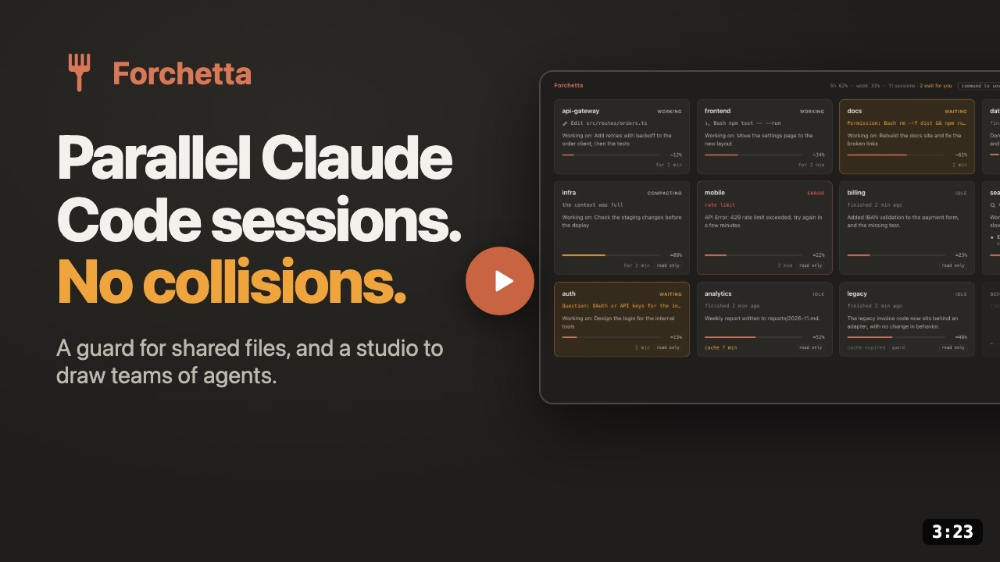
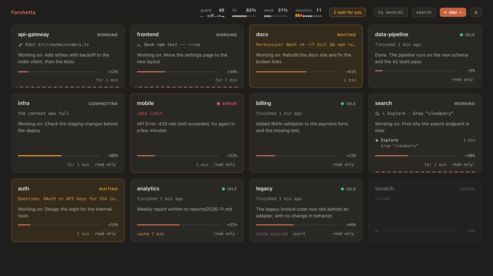

<div align="center">


# Forchetta

### Disegna un team di agenti Claude Code, e mettilo al lavoro.

Trascina gli agenti su una tela, disegna chi guida chi, e avvia il team nel tuo progetto. Ogni agente è una sessione di Claude Code: si dividono il lavoro, e Forchetta li tiene lontani dai file degli altri. Tutte le sessioni del tuo Mac, in un team o no, stanno in una finestra.

[](#installazione)
[](#installazione)
[](https://code.claude.com)
[](#cosa-tocca-sul-tuo-mac)
[](https://github.com/alessiodonato/forchetta/actions/workflows/ci.yml)
[](LICENSE)
[](https://forchetta.dev/)

[Installazione](#installazione) ·
[Disegna un team nel browser](https://forchetta.dev/studio/) ·
[Prova tutta l'app](https://forchetta.dev/demo/) ·
[Manuale (in inglese)](https://forchetta.dev/manual.html) ·
[🇬🇧 English](README.md)

<br>

<a href="https://www.youtube.com/watch?v=ZFPHyaAibCA"></a>

<sub>Forchetta in tre minuti, su YouTube (in inglese).</sub>

</div>

L'app e i comandi da terminale sono in inglese: in questo README pulsanti e messaggi sono citati come compaiono.

## Disegna un team


Un team è un gruppo di sessioni di Claude Code che lavorano insieme. Nello studio trascini gli agenti su una tela, ognuno con un ruolo, un modello, le sue skill e i suoi strumenti (un browser per il tester, sola lettura per il revisore), e tiri una freccia da ognuno agli agenti che guida. Oppure descrivi il team in una frase, e Claude lo disegna. Prima di avviarlo, lo studio ti segnala cosa nel team lavora contro sé stesso, come un revisore che potrebbe correggere il codice da solo.

Poi lo avvii con un obiettivo. Il capo, una sessione Claude oppure tu, lo divide in richieste; gli altri fanno il lavoro, e chiedono a chi sta sopra quando sono bloccati. Dove vuoi guardare prima tu, segna la freccia: le sue richieste aspettano il tuo sì. Vedi quanto costa ogni agente mentre lavora, e dopo puoi rivedere la run sulla tela. Salva il team come modello, con `{ticket}` per ciò che cambia ogni volta, e riavvialo in un altro progetto. Oppure lascia che parta da solo: le voci di una coda una alla volta, a un'ora fissa, o per ogni issue di GitHub con un'etichetta.

Lo studio c'è anche nel browser, come [Studio Maker](https://forchetta.dev/studio/): disegna un team, esportalo come file, aprilo in Forchetta. [I team nel manuale](https://forchetta.dev/manual.html#teams).

## Il vigile


<sub>Due sessioni, un file: <code>rate-limit</code> viene fermata mentre <code>retries</code> cambia <code>src/api.ts</code>, e riparte da sola quando il file è libero. Registrato nella simulazione del repository: app, daemon e vigile sono quelli veri; le due sessioni seguono un copione.</sub>

Agenti nella stessa cartella prima o poi vogliono lo stesso file. Forchetta vede ogni modifica prima che avvenga: il secondo agente viene fermato, gli viene spiegato perché, e riparte da solo quando il file è libero.

Così non c'è nessun worktree da preparare: una cartella, una sola installazione delle dipendenze, un solo server di sviluppo, niente da unire alla fine. Vale per tutte le sessioni, anche per quelle avviate con `claude` normale, e dice a ogni sessione cosa hanno cambiato le altre, proprio quando serve. [Il vigile nel manuale](https://forchetta.dev/manual.html#guard).

## Tutte le sessioni in una finestra



Ogni sessione di Claude Code del tuo Mac compare da sola, ovunque l'hai avviata: nel Terminale, in iTerm, nel tuo editor. Stessa CLI, stesse impostazioni, stessi hook tuoi. Ogni box dice cosa sta facendo la sessione, quanto è pieno il contesto e quanto costa, e diventa ambra quando aspetta te.

Rispondi a un permesso dal box. Cliccalo, e il suo terminale si apre accanto agli altri. Una notifica ti avvisa quando una sessione ti aspetta, o sembra bloccata. Avvia una sessione con `forchetta run claude`, o dall'app, e Forchetta può anche scriverci i comandi. [La finestra nel manuale](https://forchetta.dev/manual.html#window).

## Installazione

```sh
brew install alessiodonato/tap/forchetta
forchetta setup
```

`forchetta setup` compila l'app sul tuo Mac e la mette in `~/Applications`, con i Command Line Tools di Xcode che Homebrew ha già installato: niente Xcode, niente account Apple, e nessun avviso di macOS quando si apre. Poi aggiunge gli hook di Forchetta a Claude Code, mostrandoti prima ogni modifica a `~/.claude/settings.json`.

Apri Forchetta da `~/Applications`: le sessioni già aperte compaiono da sole. Perché ogni nuova sessione sia una in cui Forchetta può scrivere, aggiungi `alias claude='forchetta run claude'` a `~/.zshrc`.

Versione 0.12.0. Servono macOS 12 o successivo e Claude Code (versione verificata 2.1.322); Homebrew porta con sé Node.js e tmux. Dopo `brew upgrade forchetta`, riesegui `forchetta setup`.

Per compilarla dal codice, vedi [CONTRIBUTING.md](CONTRIBUTING.md) (in inglese).

## Prova il vigile

1. In un repository git, apri due terminali e avvia in ognuno una sessione con `forchetta run claude`.
2. Chiedi alla prima di cambiare un file e poi far girare i test: *"Aggiungi i retry in src/api.ts, poi fai girare i test."*
3. Mentre lavora, chiedi alla seconda di cambiare lo stesso file.

La seconda sessione viene fermata, dice che aspetterà `src/api.ts`, e riparte quando la prima finisce il turno. In Forchetta, i due box mostrano chi tiene il file e chi aspetta.

## Rispetto ad altri strumenti

| | Cos'è | In cosa Forchetta è diversa |
|---|---|---|
| **Agent View** (`claude agents`) | La lista a schermo intero delle sessioni in background, di Anthropic, nel terminale | Una finestra che resta aperta accanto al tuo lavoro, con i terminali affiancati, e il vigile. |
| **Claude Desktop** | L'app di Anthropic, con le sessioni in parallelo nella barra laterale | Lavora con la CLI `claude` che usi già nei tuoi terminali, con i tuoi hook e le tue impostazioni. |
| **Agent teams** (sperimentali in Claude Code) | Una sessione capo che avvia i compagni e divide con loro una lista di compiti | I team si preparano in un pannello o si disegnano in uno studio, su quanti livelli servono, e si salvano come modelli: ruolo, modello, permessi, worktree e skill per ogni membro. Il capo puoi essere tu. |
| **Conductor** e app per Mac simili | App che fanno girare più agenti, ognuno in uno spazio di lavoro isolato | Forchetta non ospita le tue sessioni: vede quelle che avvii ovunque, e le lascia lavorare nella stessa cartella senza danni. |
| **Orca**, **Paseo** | App open source per desktop e telefono che fanno girare molti tipi di agenti, ognuno nel suo worktree git | Nessun worktree da preparare: le sessioni lavorano nella stessa cartella, e il vigile le tiene lontane dai file delle altre. Funziona con il `claude` che già usi, in qualsiasi terminale. |
| **cmux**, **Claude Squad** | Terminali e gestori di sessioni per molti tipi di agenti | Fatta solo per Claude Code, attraverso i suoi hook: il vigile, permessi dal box, contesto e costo per sessione, subagenti. |

Non si escludono a vicenda: le sessioni avviate in qualsiasi terminale compaiono in Forchetta.

## E poi

Comandi a una sessione o a più insieme, testo passato da un terminale all'altro, i file cambiati da ogni sessione, team tenuti nel repository, un registro locale con i report, una palette per ogni comando (⌘K), e `forchetta doctor` quando qualcosa non è a posto. Tutto è nel [manuale](https://forchetta.dev/manual.html) (in inglese).

## Cosa tocca sul tuo Mac

- **`~/.claude/settings.json`**, solo con `forchetta setup` o `forchetta hooks install`, dopo averti mostrato ogni modifica, e con un backup. Gli hook di Forchetta si aggiungono accanto ai tuoi senza cambiarli; `forchetta hooks uninstall` toglie solo quelli.
- **Gli hook sono piccoli script `sh` + `curl`.** Terminano sempre con 0 e stampano solo una decisione: la tua risposta a un permesso, o il vigile che ferma una modifica. Con Forchetta spenta, una sessione si comporta esattamente come senza (la sua status line dice che Forchetta è spenta). Quasi tutti girano in background; il vigile fa aspettare Claude circa 30 ms, solo prima delle modifiche ai file e dei comandi Bash. [Come funzionano gli hook](https://forchetta.dev/manual.html#hooks)
- **Tutto il resto** sta in `~/Library/Application Support/Forchetta`, leggibile solo da te. Il daemon ascolta solo su `127.0.0.1`, con un token. Nessuna telemetria. L'unica chiamata esterna che porta fuori qualcosa di tuo è facoltativa e spenta di default: un riassunto di una riga scritto da Haiku, attraverso la Claude API. Quando parte un team i cui agenti hanno delle skill, Forchetta le scarica da GitHub a un commit fissato, in quella cartella. Un agente a cui dai un server MCP dello studio lo avvia con `npx`, a una versione fissata, scaricata da npm la prima volta. **Describe**, nello studio, manda quello che scrivi a Claude attraverso il tuo Claude Code, come ogni sessione, senza i tuoi file né le tue impostazioni. Un team che parte da GitHub legge le issue o le pull request con il tuo `gh`, e lì non scrive mai.
- **`~/Library/LaunchAgents/dev.forchetta.daemon.plist`**, solo se lanci `forchetta daemon keepalive on`, perché macOS tenga acceso il daemon.
- A riposo, app, pagina e daemon insieme restano sotto l'1% della CPU.

## Funziona con arricurdAI

[arricurdAI](https://github.com/alessiodonato/arricurdai) tiene piccolo il contesto di Claude Code e mostra dove vanno i token. Forchetta funziona anche senza; con arricurdAI mostra in più il countdown della cache di ogni sessione, il costo di oggi, la ricerca nelle sessioni passate, e una nota per la nuova conversazione prima di un `/clear`.

## Disinstallazione

1. `forchetta hooks uninstall`: toglie solo gli hook di Forchetta, dopo averti chiesto, e ti restituisce la tua statusline.
2. `forchetta daemon keepalive off`, se l'avevi acceso, poi `forchetta daemon stop`. Le sessioni avviate con `forchetta run` continuano finché non le chiudi con `/exit`.
3. `brew uninstall forchetta` e `brew untap alessiodonato/tap`.
4. Cancella `~/Applications/Forchetta.app` e `~/Library/Application Support/Forchetta`.

## Contribuire

Forchetta è giovane e ha un solo manutentore. I bug vanno nelle [issue](https://github.com/alessiodonato/forchetta/issues/new/choose), idee e domande nelle [discussioni](https://github.com/alessiodonato/forchetta/discussions). [CONTRIBUTING.md](CONTRIBUTING.md) (in inglese) spiega come compilarla e come provare una modifica in una simulazione, senza sessioni vere e senza spendere token.

## Licenza

Apache 2.0: vedi [LICENSE](LICENSE). I terminali dell'app usano [JetBrains Mono](https://github.com/JetBrains/JetBrainsMono), con licenza SIL Open Font License 1.1: vedi [src/ui/fonts/OFL.txt](src/ui/fonts/OFL.txt).

<sub>*Forchetta* in inglese si dice *fork*: un manico, più rebbi.</sub>
