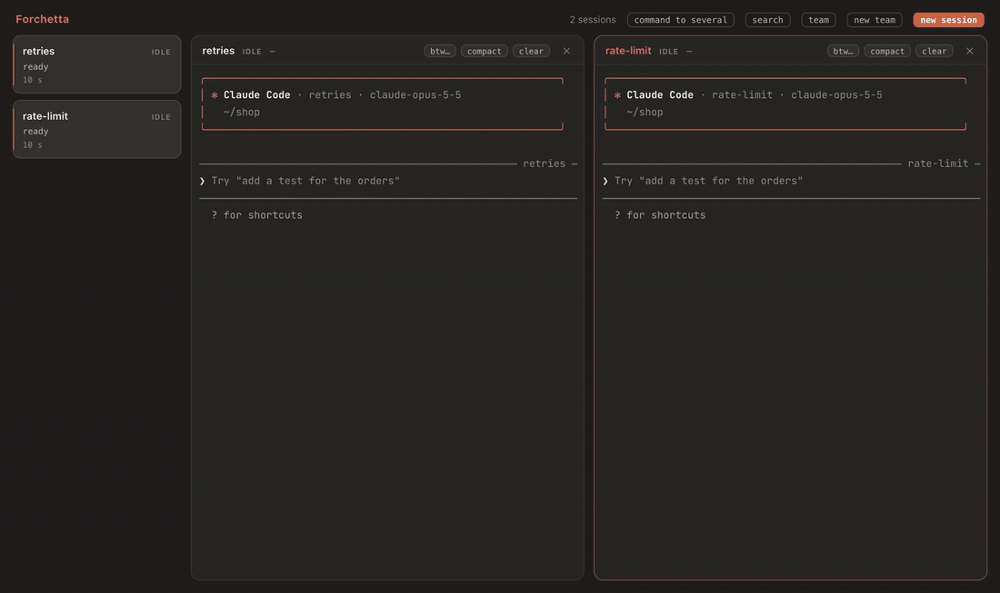
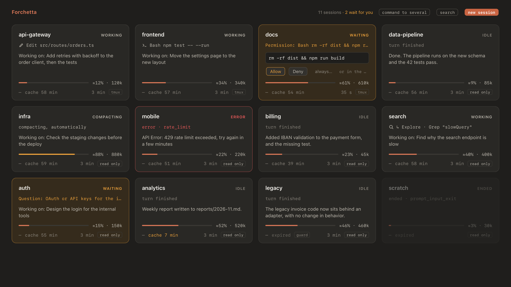

<div align="center">


# Forchetta

### Run several Claude Code sessions in the same repo. They won't step on each other.

When two sessions reach for the same file, Forchetta makes one wait, tells Claude why, and lets it go on by itself when the file is free. Around that: every Claude Code session on your Mac in one window, permission prompts answered from there, a notification when one needs you, and teams of agents.

[](#install)
[](#install)
[](https://code.claude.com)
[](#what-it-touches-on-your-mac)
[](https://github.com/alessiodonato/forchetta/actions/workflows/ci.yml)
[](LICENSE)
[](https://alessiodonato.github.io/forchetta/)

[Install](#install) ·
[The guard](#the-guard) ·
[How it compares](#how-it-compares) ·
[Manual](https://alessiodonato.github.io/forchetta/manual.html) ·
[🇮🇹 Italiano](README.it.md)

<br>



<sub>Two sessions, one file: <code>rate-limit</code> is stopped while <code>retries</code> changes <code>src/api.ts</code>, and goes on by itself when the file is free. Recorded in the repository's simulation: the app, the daemon and the guard are real; the two sessions are scripted.</sub>

</div>

## Why Forchetta

### The guard

The usual way to run agents in parallel is a git worktree for each one. Then each worktree needs its own dependencies, its own `.env` and its own dev server, and you merge at the end. Forchetta lets sessions work side by side in one folder too:

- a session **holds** the files it writes during its turn;
- another session that tries to edit one of them is stopped, and Claude reads why: it works on something else, or ends its turn saying it waits;
- when the turn that held the file ends, the waiting session is told the file is free, and goes on by itself;
- a git command that would change the files under another session (`checkout`, `reset --hard`, `stash`, `pull`…) asks you first.

It works for every session, also those started with plain `claude`. **let it through** in the box overrides it. [The guard in the manual](https://alessiodonato.github.io/forchetta/manual.html#guard).

### It works with the `claude` you already run

Forchetta listens to Claude Code through its hooks, so your sessions show up wherever you started them: the Terminal, iTerm, your editor. Same CLI, same settings, same hooks of yours. No account, no new agent runtime, and nothing about your sessions leaves your Mac.

Start a session with `forchetta run claude`, or from the app, and Forchetta can also open its terminal and type commands into it.

### One window for all of them



- A live box per session: its state, what it is doing now, a short summary, its context and its cost. Amber when it waits for you, green when it's done, red on an error.
- Answer permission prompts from the box, once or "always".
- A notification when a session waits for you, seems stuck, or ends with an error.
- Up to four real terminals side by side.

### Teams, when you want them

A lead, which is a Claude session or you, and up to 6 members. Each member is a full Claude Code session with its own role and model, and by default its own worktree. The lead hands out requests through an MCP server; members answer, or ask the lead when they're stuck. Save a team as a template and start it again in another project. [Teams in the manual](https://alessiodonato.github.io/forchetta/manual.html#teams).

## How it compares

| | What it is | How Forchetta differs |
|---|---|---|
| **Agent View** (`claude agents`) | Anthropic's full-screen list of your background sessions, in the terminal | A window that stays open next to your work, with terminals side by side, and the guard. |
| **Claude Desktop** | Anthropic's app, with parallel sessions in its sidebar | It works with the `claude` CLI you already run in your terminals, with your hooks and settings. |
| **Agent teams** (experimental in Claude Code) | A lead session that spawns teammates and shares a task list with them | Teams are set up in a panel and saved as templates: role, model, permissions and worktree for each member. The lead can be you. |
| **Conductor** and similar Mac apps | Apps that run several coding agents, each in an isolated workspace | Forchetta doesn't host your sessions: it sees the ones you start anywhere, and lets them share a folder safely. |
| **cmux**, **Claude Squad** | Terminals and session managers for many kinds of coding agents | Built for Claude Code only, through its hooks: the guard, permissions from the box, context and cost per session, subagents. |

They don't rule each other out: sessions started in any terminal show up in Forchetta.

## Install

```sh
brew install alessiodonato/tap/forchetta
forchetta setup
```

`forchetta setup` builds the app on your Mac and puts it in `~/Applications`, with the Xcode Command Line Tools Homebrew already installed: no Xcode, no Apple account, and no warning from macOS when it opens. Then it adds the hooks of Forchetta to Claude Code, showing you every change to `~/.claude/settings.json` before it writes.

Open Forchetta from `~/Applications`: the sessions already running appear on their own. To make every new session one Forchetta can type into, add `alias claude='forchetta run claude'` to `~/.zshrc`.

Version 0.9.3. You need macOS 12 or later and Claude Code (tested with 2.1.322); Homebrew brings Node.js and tmux. After `brew upgrade forchetta`, run `forchetta setup` again.

To build it from source, see [CONTRIBUTING.md](CONTRIBUTING.md).

## Try the guard

1. In a git repository, open two terminals and start a session in each with `forchetta run claude`.
2. Ask the first one to change a file and then run the tests: *"Add retries to src/api.ts, then run the tests."*
3. While it works, ask the second one to change the same file.

The second session is stopped, says it will wait for `src/api.ts`, and goes on when the first one ends its turn. In Forchetta, both boxes show who holds the file and who waits.

## What else it does

- **Commands**: `/btw`, `/compact` and `/clear` to one session or to several, typed only when it's safe: never into a dialog, never over a draft of yours. [More](https://alessiodonato.github.io/forchetta/manual.html#commands)
- **Hand-offs**: select text in a terminal to ask Claude about it, or to send it to another session. [More](https://alessiodonato.github.io/forchetta/manual.html#selection)
- **What each session did**: the files it changed, its subagents at work, the artifacts it published on claude.ai, and a warning when two sessions wrote the same file. [More](https://alessiodonato.github.io/forchetta/manual.html#changes)
- **New sessions and teams from the app**, with model, permission mode and worktree. [More](https://alessiodonato.github.io/forchetta/manual.html#new-session)
- **Names, groups and roles**, with an org chart. [More](https://alessiodonato.github.io/forchetta/manual.html#window)
- **Menu bar icon**, Dock badge and the shortcut ⌃⌥F. [More](https://alessiodonato.github.io/forchetta/manual.html#alerts)
- **`forchetta ls --json`**, for scripts. [More](https://alessiodonato.github.io/forchetta/manual.html#cli)

Everything is in the [manual](https://alessiodonato.github.io/forchetta/manual.html).

## What it touches on your Mac

- **`~/.claude/settings.json`**, only with `forchetta setup` or `forchetta hooks install`, after showing you every change, and with a backup. The hooks of Forchetta go next to yours without changing them; `forchetta hooks uninstall` removes only them.
- **The hooks are small `sh` + `curl` scripts.** They always exit with 0, and print only a decision: your answer to a permission, or the guard stopping an edit. With Forchetta off, a session behaves exactly as without it. Most run in the background; the guard makes Claude wait about 30 ms, only before edits and Bash commands. [How the hooks work](https://alessiodonato.github.io/forchetta/manual.html#hooks)
- **Everything else** stays in `~/Library/Application Support/Forchetta`, readable only by you. The daemon listens on `127.0.0.1` only, with a token. No telemetry. The one outside call is optional and off by default: a one-line summary of a session by Haiku, through the Claude API.
- At rest, the app, the page and the daemon together stay under 1% of CPU.

## Works with arricurdAI

[arricurdAI](https://github.com/alessiodonato/arricurdai) keeps the context of Claude Code small and shows where your tokens go. Forchetta works without it; with it, Forchetta also shows the prompt-cache countdown of each session, the cost of today, a search through earlier sessions, and a note for the new conversation before a `/clear`.

## Uninstall

1. `forchetta hooks uninstall`: removes only the hooks of Forchetta, after asking, and gives you back your status line.
2. `forchetta daemon stop`. Sessions started with `forchetta run` go on until you `/exit` them.
3. `brew uninstall forchetta` and `brew untap alessiodonato/tap`.
4. Delete `~/Applications/Forchetta.app` and `~/Library/Application Support/Forchetta`.

## Contributing

Forchetta is young and has one maintainer. Bugs go in [issues](https://github.com/alessiodonato/forchetta/issues/new/choose), ideas and questions in [discussions](https://github.com/alessiodonato/forchetta/discussions). [CONTRIBUTING.md](CONTRIBUTING.md) explains how to build it and how to try a change in a simulation, with no real sessions and no tokens spent.

## License

Apache 2.0: see [LICENSE](LICENSE). The terminals of the app use [JetBrains Mono](https://github.com/JetBrains/JetBrainsMono), under the SIL Open Font License 1.1: see [src/ui/fonts/OFL.txt](src/ui/fonts/OFL.txt).

<sub>*Forchetta* is Italian for *fork*: one handle, several tines.</sub>
