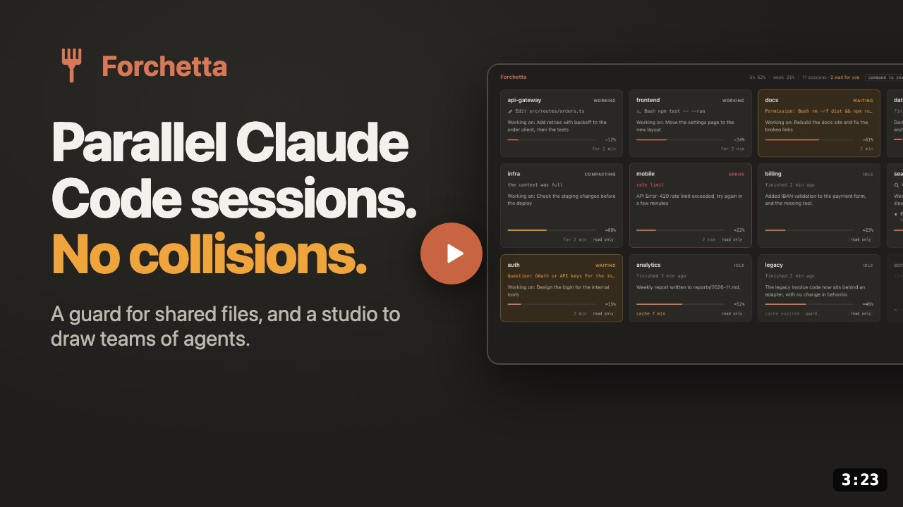
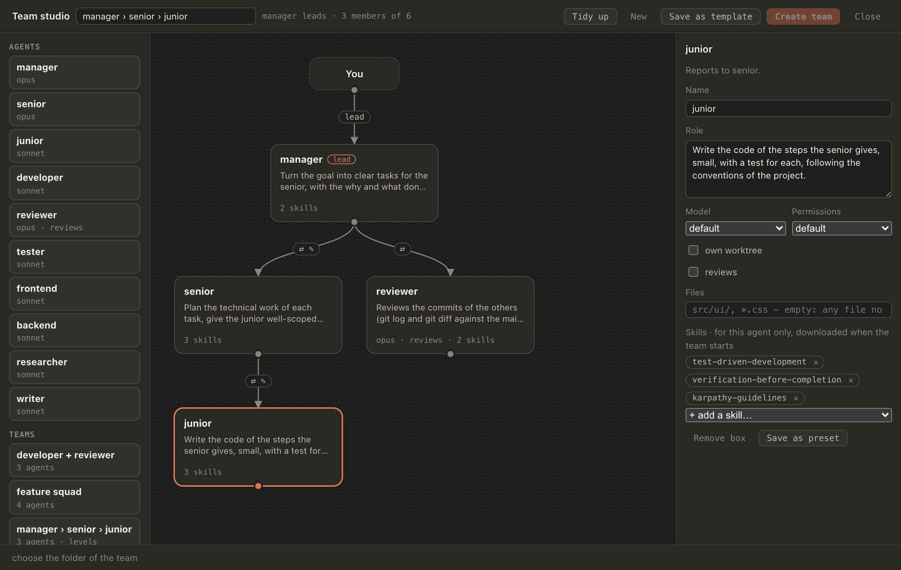
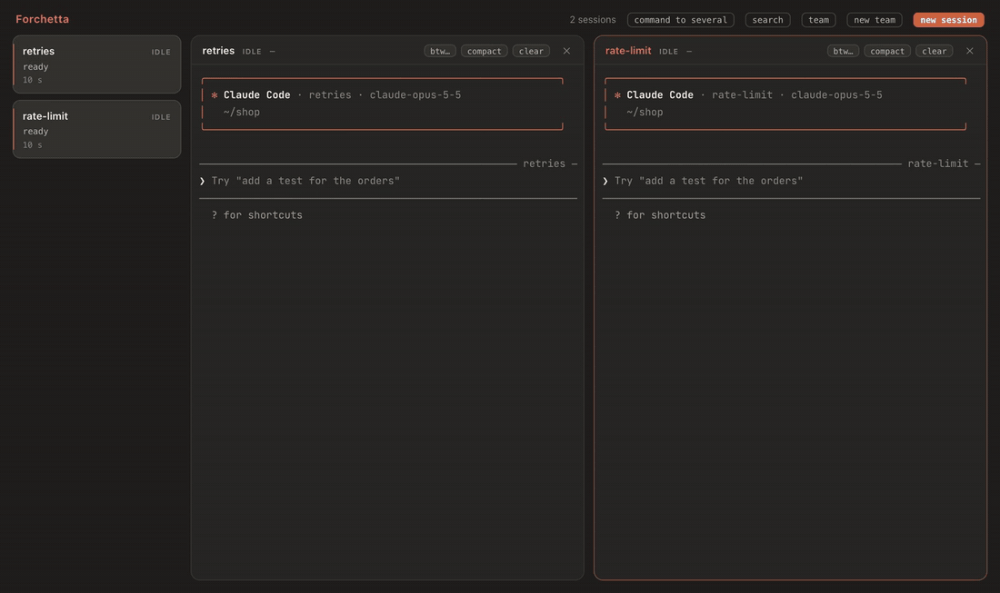
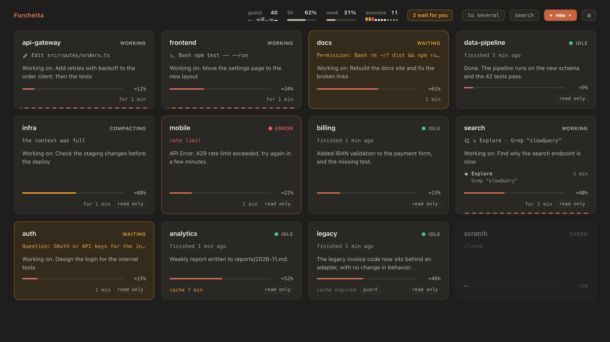

<div align="center">


# Forchetta

### Draw a team of Claude Code agents, and put it to work.

Drag the agents onto a canvas, draw who leads whom, and start the team in your project. Each agent is a Claude Code session: they split the work, and Forchetta keeps them off each other's files. Every session on your Mac, in a team or not, sits in one window.

[](#install)
[](#install)
[](https://code.claude.com)
[](#what-it-touches-on-your-mac)
[](https://github.com/alessiodonato/forchetta/actions/workflows/ci.yml)
[](LICENSE)
[](https://forchetta.dev/)

[Install](#install) ·
[Draw a team in your browser](https://forchetta.dev/studio/) ·
[Try the whole app](https://forchetta.dev/demo/) ·
[Manual](https://forchetta.dev/manual.html) ·
[🇮🇹 Italiano](README.it.md)

<br>

<a href="https://www.youtube.com/watch?v=ZFPHyaAibCA"></a>

<sub>Forchetta in three minutes, on YouTube.</sub>

</div>

## Draw a team



A team is a few Claude Code sessions that work together. In the studio you drag the agents onto a canvas, each with a role, a model, its skills and its tools (a browser for the tester, read-only for the reviewer), and pull an arrow from each one to the agents it leads. Or describe the team in a sentence, and Claude draws it.

Then you start it with a goal. The lead, a Claude session or you, splits it into requests; the others do the work, and ask the one above them when they're stuck. Where you want to look first, mark the arrow: its requests wait for your yes. You see what each agent costs while it works, and afterwards you can replay the run on the canvas. Save the team as a template, with `{ticket}` for what changes each time, and start it again in another project.

The studio is also in your browser, as the [Studio Maker](https://forchetta.dev/studio/): draw a team, export it as a file, open it in Forchetta. [Teams in the manual](https://forchetta.dev/manual.html#teams).

## The guard



<sub>Two sessions, one file: <code>rate-limit</code> is stopped while <code>retries</code> changes <code>src/api.ts</code>, and goes on by itself when the file is free. Recorded in the repository's simulation: the app, the daemon and the guard are real; the two sessions are scripted.</sub>

Agents in the same folder sooner or later reach for the same file. Forchetta sees every edit before it happens: the second one is stopped and told why, and goes on by itself when the file is free.

So there's no worktree to set up: one folder, one set of dependencies, one dev server, nothing to merge at the end. It works for every session, also one you start with plain `claude`, and it tells each session what the others changed, right when it matters. [The guard in the manual](https://forchetta.dev/manual.html#guard).

## Every session in one window



Every Claude Code session on your Mac shows up by itself, wherever you started it: the Terminal, iTerm, your editor. Same CLI, same settings, same hooks of yours. Each box tells you what the session is doing, how full its context is and what it costs, and turns amber when it waits for you.

Answer a permission from the box. Click it, and its terminal opens next to the others. A notification tells you when a session waits for you, or seems stuck. Start a session with `forchetta run claude`, or from the app, and Forchetta can also type commands into it. [The window in the manual](https://forchetta.dev/manual.html#window).

## Install

```sh
brew install alessiodonato/tap/forchetta
forchetta setup
```

`forchetta setup` builds the app on your Mac and puts it in `~/Applications`, with the Xcode Command Line Tools Homebrew already installed: no Xcode, no Apple account, and no warning from macOS when it opens. Then it adds the hooks of Forchetta to Claude Code, showing you every change to `~/.claude/settings.json` before it writes.

Open Forchetta from `~/Applications`: the sessions already running appear on their own. To make every new session one Forchetta can type into, add `alias claude='forchetta run claude'` to `~/.zshrc`.

Version 0.11.0. You need macOS 12 or later and Claude Code (tested with 2.1.322); Homebrew brings Node.js and tmux. After `brew upgrade forchetta`, run `forchetta setup` again.

To build it from source, see [CONTRIBUTING.md](CONTRIBUTING.md).

## Try the guard

1. In a git repository, open two terminals and start a session in each with `forchetta run claude`.
2. Ask the first one to change a file and then run the tests: *"Add retries to src/api.ts, then run the tests."*
3. While it works, ask the second one to change the same file.

The second session is stopped, says it will wait for `src/api.ts`, and goes on when the first one ends its turn. In Forchetta, both boxes show who holds the file and who waits.

## How it compares

| | What it is | How Forchetta differs |
|---|---|---|
| **Agent View** (`claude agents`) | Anthropic's full-screen list of your background sessions, in the terminal | A window that stays open next to your work, with terminals side by side, and the guard. |
| **Claude Desktop** | Anthropic's app, with parallel sessions in its sidebar | It works with the `claude` CLI you already run in your terminals, with your hooks and settings. |
| **Agent teams** (experimental in Claude Code) | A lead session that spawns teammates and shares a task list with them | Teams are set up in a panel or drawn in a studio, on as many levels as you need, and saved as templates: role, model, permissions, worktree and skills for each member. The lead can be you. |
| **Conductor** and similar Mac apps | Apps that run several coding agents, each in an isolated workspace | Forchetta doesn't host your sessions: it sees the ones you start anywhere, and lets them share a folder safely. |
| **Orca**, **Paseo** | Open-source desktop and phone apps that run many kinds of coding agents, each in its own git worktree | No worktree to set up: sessions share one folder, and the guard keeps them off each other's files. It works with the `claude` you already run, in any terminal. |
| **cmux**, **Claude Squad** | Terminals and session managers for many kinds of coding agents | Built for Claude Code only, through its hooks: the guard, permissions from the box, context and cost per session, subagents. |

They don't rule each other out: sessions started in any terminal show up in Forchetta.

## And more

Commands to one session or to several, text handed from one terminal to another, the files each session changed, teams kept in the repository, a local ledger with reports, a palette for every command (⌘K), and `forchetta doctor` when something is not in place. Everything is in the [manual](https://forchetta.dev/manual.html).

## What it touches on your Mac

- **`~/.claude/settings.json`**, only with `forchetta setup` or `forchetta hooks install`, after showing you every change, and with a backup. The hooks of Forchetta go next to yours without changing them; `forchetta hooks uninstall` removes only them.
- **The hooks are small `sh` + `curl` scripts.** They always exit with 0, and print only a decision: your answer to a permission, or the guard stopping an edit. With Forchetta off, a session behaves exactly as without it (its status line says Forchetta is off). Most run in the background; the guard makes Claude wait about 30 ms, only before edits and Bash commands. [How the hooks work](https://forchetta.dev/manual.html#hooks)
- **Everything else** stays in `~/Library/Application Support/Forchetta`, readable only by you. The daemon listens on `127.0.0.1` only, with a token. No telemetry. The one outside call that carries anything of yours is optional and off by default: a one-line summary of a session by Haiku, through the Claude API. When a team whose agents have skills starts, Forchetta fetches those skills from GitHub at a pinned commit, into that folder. An agent you give an MCP server of the studio runs it with `npx`, at a pinned version, fetched from npm the first time. **Describe**, in the studio, sends what you write to Claude through your own Claude Code, as any session does, with none of your files or settings.
- **`~/Library/LaunchAgents/dev.forchetta.daemon.plist`**, only if you run `forchetta daemon keepalive on`, so that macOS keeps the daemon alive.
- At rest, the app, the page and the daemon together stay under 1% of CPU.

## Works with arricurdAI

[arricurdAI](https://github.com/alessiodonato/arricurdai) keeps the context of Claude Code small and shows where your tokens go. Forchetta works without it; with it, Forchetta also shows the prompt-cache countdown of each session, the cost of today, a search through earlier sessions, and a note for the new conversation before a `/clear`.

## Uninstall

1. `forchetta hooks uninstall`: removes only the hooks of Forchetta, after asking, and gives you back your status line.
2. `forchetta daemon keepalive off`, if you turned it on, then `forchetta daemon stop`. Sessions started with `forchetta run` go on until you `/exit` them.
3. `brew uninstall forchetta` and `brew untap alessiodonato/tap`.
4. Delete `~/Applications/Forchetta.app` and `~/Library/Application Support/Forchetta`.

## Contributing

Forchetta is young and has one maintainer. Bugs go in [issues](https://github.com/alessiodonato/forchetta/issues/new/choose), ideas and questions in [discussions](https://github.com/alessiodonato/forchetta/discussions). [CONTRIBUTING.md](CONTRIBUTING.md) explains how to build it and how to try a change in a simulation, with no real sessions and no tokens spent.

## License

Apache 2.0: see [LICENSE](LICENSE). The terminals of the app use [JetBrains Mono](https://github.com/JetBrains/JetBrainsMono), under the SIL Open Font License 1.1: see [src/ui/fonts/OFL.txt](src/ui/fonts/OFL.txt).

<sub>*Forchetta* is Italian for *fork*: one handle, several tines.</sub>
